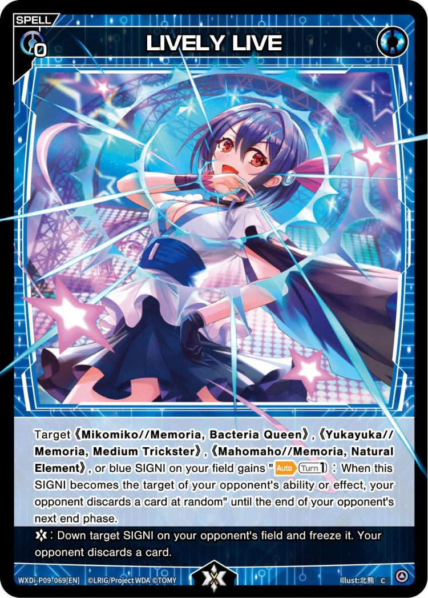

# LIVELY LIVE

## Thông tin lá

| Trường | Giá trị |
| --- | --- |
| Mã in | WXDi-P09-069[EN] |
| Set | WXDi-P09[EN] |
| Số thứ tự | 069 |
| Loại thẻ | SPELL |
| Vị trí | Main Deck |
| Số bản | — (set booster, không áp dụng) |
| Màu | Xanh dương |
| Độ hiếm | C,C(P) |
| Minh họa | 北熊 |
| Level | — |
| Limit | — |
| Power | 0 |
| LRIG type / Class | — |
| Team / Master | — |
| Cost | 《U》×０ |
| Grow cost | — |
| Use timing | — |
| Life Burst | Có |

## Card text chính thức

Target 《Mikomiko//Memoria, Bacteria Queen》, 《Yukayuka//Memoria, Medium Trickster》, 《Mahomaho//Memoria, Natural Element》, or blue SIGNI on your field gains "[Auto] {1/Turn}: When this SIGNI becomes the target of your opponent's ability or effect, your opponent discards a card at random" until the end of your opponent's next end phase.

## Power text / Life Burst

Down target SIGNI on your opponent's field and freeze it. Your opponent discards a card.

## Ghi chú minh họa
Artist: 北熊. Ảnh C được tải từ Card List tiếng Anh.

## FAQ chính thức

**Q. Does the gained [Auto] ability trigger if the SIGNI that obtained it through this spell becomes the target of an effect that banishes SIGNI or lose SIGNI's abilities?**
A. Yes, it triggers. It triggers when it becomes the target and resolves after the effect that vanishes or causes the loss of abilities. At that point, the SIGNI may have already been vanished or lost its abilities, but once the ability has triggered, it resolves as normal.

## Ảnh biến thể

- [C(P)](../images/WXDi-P09-069P-EN.jpg)

## Nguồn
[Card List/FAQ chính thức](https://www.takaratomy.co.jp/products/en.wixoss/card/card.html?card_no=WXDi-P09-069%5BEN%5D ) · [Ảnh thẻ](https://www.takaratomy.co.jp/products/en.wixoss/card/thumb/WXDi-P09-069%5BEN%5D.jpg)
