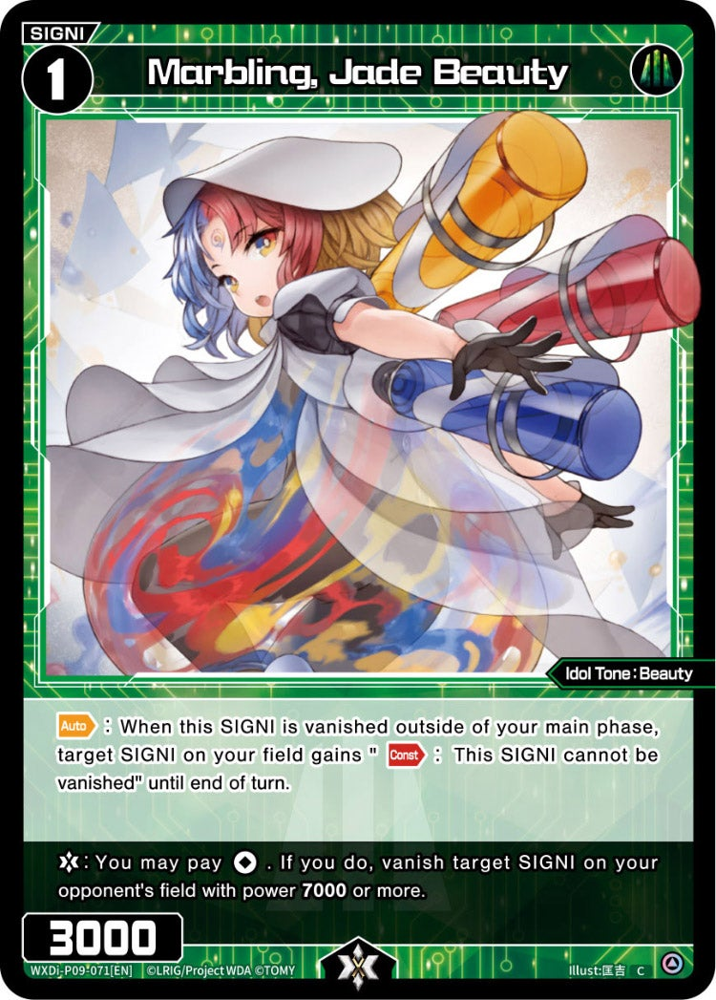

# Marbling, Jade Beauty

## Thông tin lá

| Trường | Giá trị |
| --- | --- |
| Mã in | WXDi-P09-071[EN] |
| Set | WXDi-P09[EN] |
| Số thứ tự | 071 |
| Loại thẻ | SIGNI |
| Vị trí | Main Deck |
| Số bản | — (set booster, không áp dụng) |
| Màu | Xanh lá |
| Độ hiếm | C,C(P) |
| Minh họa | 匡吉 |
| Level | 1 |
| Limit | — |
| Power | 3000 |
| LRIG type / Class | Idol Tone：Beauty |
| Team / Master | — |
| Cost | — |
| Grow cost | — |
| Use timing | — |
| Life Burst | Có |

## Card text chính thức

[Auto]: When this SIGNI is vanished outside of your main phase, target SIGNI on your field gains "[Constant]: This SIGNI cannot be vanished" until end of turn.

## Power text / Life Burst

You may pay {Colorless}. If you do, vanish target SIGNI on your opponent's field with power 7000 or more.

## Ghi chú minh họa
Artist: 匡吉. Ảnh C được tải từ Card List tiếng Anh.

## FAQ chính thức

**Q. Is the [Auto] ability triggered if this SIGNI is vanished in battle?**
A. Yes, it is triggered.

## Ảnh biến thể

- [C(P)](../images/WXDi-P09-071P-EN.jpg)

## Nguồn
[Card List/FAQ chính thức](https://www.takaratomy.co.jp/products/en.wixoss/card/card.html?card_no=WXDi-P09-071%5BEN%5D ) · [Ảnh thẻ](https://www.takaratomy.co.jp/products/en.wixoss/card/thumb/WXDi-P09-071%5BEN%5D.jpg)
