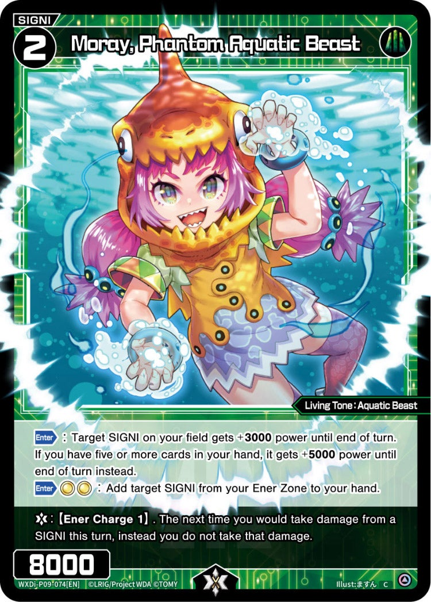

# Moray, Phantom Aquatic Beast

## Thông tin lá

| Trường | Giá trị |
| --- | --- |
| Mã in | WXDi-P09-074[EN] |
| Set | WXDi-P09[EN] |
| Số thứ tự | 074 |
| Loại thẻ | SIGNI |
| Vị trí | Main Deck |
| Số bản | — (set booster, không áp dụng) |
| Màu | Xanh lá |
| Độ hiếm | C,C(P) |
| Minh họa | ますん |
| Level | 2 |
| Limit | — |
| Power | 8000 |
| LRIG type / Class | Living Tone：Aquatic Beast |
| Team / Master | — |
| Cost | — |
| Grow cost | — |
| Use timing | — |
| Life Burst | Có |

## Card text chính thức

[Enter]: Target SIGNI on your field gets +3000 power until end of turn. If you have five or more cards in your hand, it gets +5000 power until end of turn instead.
[Enter] {Coin Icon} {Coin Icon}: Add target SIGNI from your Ener Zone to your hand.

## Power text / Life Burst

【Ener Charge 1】. The next time you would take damage from a SIGNI this turn, instead you do not take that damage.

## Ghi chú minh họa
Artist: ますん. Ảnh C được tải từ Card List tiếng Anh.

## FAQ chính thức

**Q. May I trigger the first [Enter] ability after triggering the second [Enter] ability and adding a SIGNI from the Ener zone to my hand?**
A. Yes, you can trigger [Enter] abilities in any order you like. If the second [Enter] ability adds a SIGNI to your hand and you have a total of five cards in your hand, you can use the first [Enter] ability to get +5000 power.

## Ảnh biến thể

- [C(P)](../images/WXDi-P09-074P-EN.jpg)

## Nguồn
[Card List/FAQ chính thức](https://www.takaratomy.co.jp/products/en.wixoss/card/card.html?card_no=WXDi-P09-074%5BEN%5D ) · [Ảnh thẻ](https://www.takaratomy.co.jp/products/en.wixoss/card/thumb/WXDi-P09-074%5BEN%5D.jpg)
