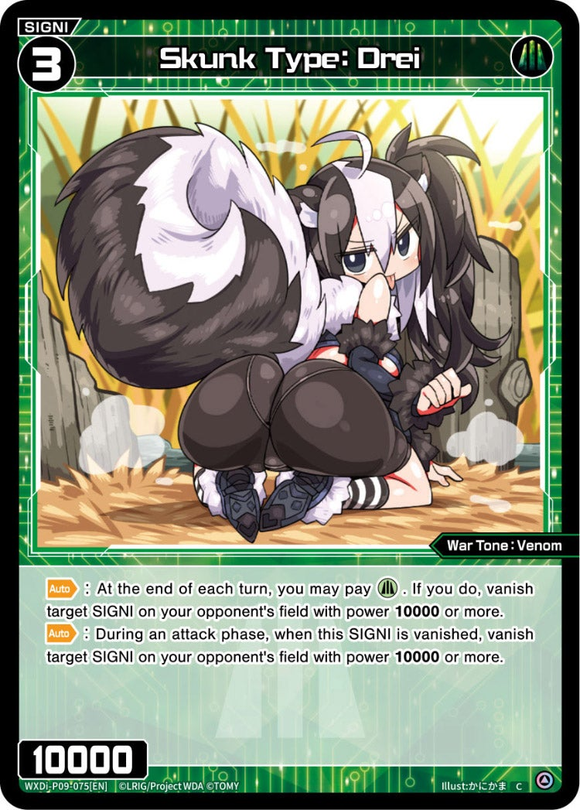

# Skunk Type: Drei

## Thông tin lá

| Trường | Giá trị |
| --- | --- |
| Mã in | WXDi-P09-075[EN] |
| Set | WXDi-P09[EN] |
| Số thứ tự | 075 |
| Loại thẻ | SIGNI |
| Vị trí | Main Deck |
| Số bản | — (set booster, không áp dụng) |
| Màu | Xanh lá |
| Độ hiếm | C,C(P) |
| Minh họa | かにかま |
| Level | 3 |
| Limit | — |
| Power | 10000 |
| LRIG type / Class | War Tone：Venom |
| Team / Master | — |
| Cost | — |
| Grow cost | — |
| Use timing | — |
| Life Burst | Không |

## Card text chính thức

[Auto]: At the end of each turn, you may pay {Green}. If you do, vanish target SIGNI on your opponent's field with power 10000 or more.
[Auto]: During an attack phase, when this SIGNI is vanished, vanish target SIGNI on your opponent's field with power 10000 or more.

## Power text / Life Burst

—

## Ghi chú minh họa
Artist: かにかま. Ảnh C được tải từ Card List tiếng Anh.

## FAQ chính thức

**Q. Does the [Auto] ability trigger if this SIGNI is vanished in battle?**
A. Yes, it is triggered.

## Ảnh biến thể

- [C(P)](../images/WXDi-P09-075P-EN.jpg)

## Nguồn
[Card List/FAQ chính thức](https://www.takaratomy.co.jp/products/en.wixoss/card/card.html?card_no=WXDi-P09-075%5BEN%5D ) · [Ảnh thẻ](https://www.takaratomy.co.jp/products/en.wixoss/card/thumb/WXDi-P09-075%5BEN%5D.jpg)
