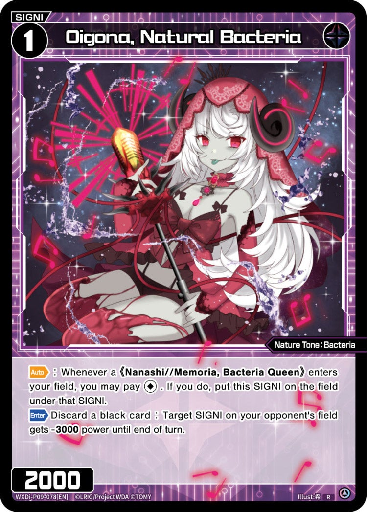

# Oigona, Natural Bacteria

## Thông tin lá

| Trường | Giá trị |
| --- | --- |
| Mã in | WXDi-P09-078[EN] |
| Set | WXDi-P09[EN] |
| Số thứ tự | 078 |
| Loại thẻ | SIGNI |
| Vị trí | Main Deck |
| Số bản | — (set booster, không áp dụng) |
| Màu | Đen |
| Độ hiếm | R,R(P) |
| Minh họa | 希 |
| Level | 1 |
| Limit | — |
| Power | 2000 |
| LRIG type / Class | Nature Tone：Bacteria |
| Team / Master | — |
| Cost | — |
| Grow cost | — |
| Use timing | — |
| Life Burst | Không |

## Card text chính thức

[Auto]: Whenever a 《Nanashi//Memoria, Bacteria Queen》 enters your field, you may pay {Colorless}. If you do, put this SIGNI on the field under that SIGNI.
[Enter] Discard a black card: Target SIGNI on your opponent's field gets -3000 power until end of turn.

## Power text / Life Burst

—

## Ghi chú minh họa
Artist: 希. Ảnh R được tải từ Card List tiếng Anh.

## FAQ chính thức

**Q. May I put 《Nanashi//Memoria, Bacteria Queen》 on top of 《Oigona, Natural Bacteria》 when my SIGNI zone is already full with three SIGNI including 《Oigona, Natural Bacteria》?**
A. No, you cannot. 《Nanashi//Memoria, Bacteria Queen》 needs to be put on an empty SIGNI zone.

## Ảnh biến thể

- [R(P)](../images/WXDi-P09-078P-EN.jpg)

## Nguồn
[Card List/FAQ chính thức](https://www.takaratomy.co.jp/products/en.wixoss/card/card.html?card_no=WXDi-P09-078%5BEN%5D ) · [Ảnh thẻ](https://www.takaratomy.co.jp/products/en.wixoss/card/thumb/WXDi-P09-078%5BEN%5D.jpg)
