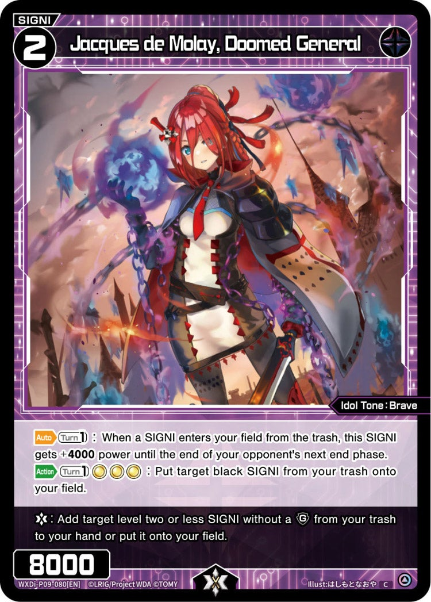

# Jacques de Molay, Doomed General

## Thông tin lá

| Trường | Giá trị |
| --- | --- |
| Mã in | WXDi-P09-080[EN] |
| Set | WXDi-P09[EN] |
| Số thứ tự | 080 |
| Loại thẻ | SIGNI |
| Vị trí | Main Deck |
| Số bản | — (set booster, không áp dụng) |
| Màu | Đen |
| Độ hiếm | C,C(P) |
| Minh họa | はしもとなおや |
| Level | 2 |
| Limit | — |
| Power | 8000 |
| LRIG type / Class | Idol Tone：Brave |
| Team / Master | — |
| Cost | — |
| Grow cost | — |
| Use timing | — |
| Life Burst | Có |

## Card text chính thức

[Auto] {1/Turn}: When a SIGNI enters your field from the trash, this SIGNI gets +4000 power until the end of your opponent's next end phase.
[Action] {1/Turn} {Coin Icon} {Coin Icon} {Coin Icon}: Put target black SIGNI from your trash onto your field.

## Power text / Life Burst

Add target level two or less SIGNI without a {Guard Icon} from your trash to your hand or put it onto your field.

## Ghi chú minh họa
Artist: はしもとなおや. Ảnh C được tải từ Card List tiếng Anh.

## FAQ chính thức

**Q. Does the first [Auto] ability continue to get +4000 power effect to my SIGNI until the end of my opponent's turn after it is brought from my trash to the field during my opponent's turn?**
A. Yes, it will continue to provide the +4000 power effect until the end of that your opponent's turn.

**Q. Does the first [Auto] ability trigger when this SIGNI itself is put from my trash on the field?**
A. Yes, it is triggered.

## Ảnh biến thể

- [C(P)](../images/WXDi-P09-080P-EN.jpg)

## Nguồn
[Card List/FAQ chính thức](https://www.takaratomy.co.jp/products/en.wixoss/card/card.html?card_no=WXDi-P09-080%5BEN%5D ) · [Ảnh thẻ](https://www.takaratomy.co.jp/products/en.wixoss/card/thumb/WXDi-P09-080%5BEN%5D.jpg)
