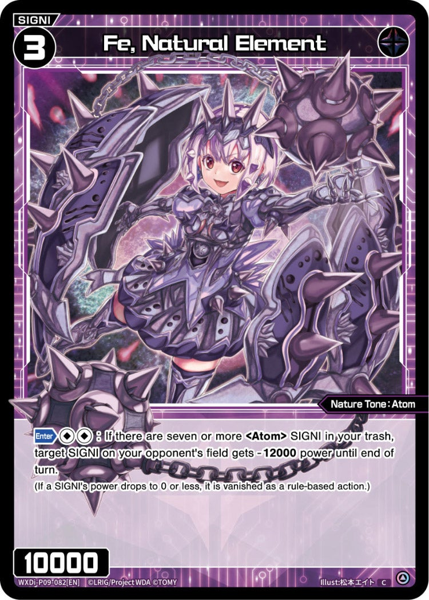

# Fe, Natural Element

## Thông tin lá

| Trường | Giá trị |
| --- | --- |
| Mã in | WXDi-P09-082[EN] |
| Set | WXDi-P09[EN] |
| Số thứ tự | 082 |
| Loại thẻ | SIGNI |
| Vị trí | Main Deck |
| Số bản | — (set booster, không áp dụng) |
| Màu | Đen |
| Độ hiếm | C,C(P) |
| Minh họa | 松本エイト |
| Level | 3 |
| Limit | — |
| Power | 10000 |
| LRIG type / Class | Nature Tone：Atom |
| Team / Master | — |
| Cost | — |
| Grow cost | — |
| Use timing | — |
| Life Burst | Không |

## Card text chính thức

[Enter] {Colorless} {Colorless}: If there are seven or more <Atom> SIGNI in your trash, target SIGNI on your opponent's field gets -12000 power until end of turn.
(If a SIGNI's power drops to 0 or less, it is vanished as a rule-based action.)

## Power text / Life Burst

—

## Ghi chú minh họa
Artist: 松本エイト. Ảnh C được tải từ Card List tiếng Anh.

## FAQ chính thức

**Q. Do you count the number of <Atom> SIGNI in my trash after paying the cost of {colorless} {colorless}?**
A. Yes, you count the number of <Atom> SIGNI after paying the Ener cost, so if there are any <Atom> SIGNI in your trash after paying the cost, you include them in the count.

## Ảnh biến thể

- [C(P)](../images/WXDi-P09-082P-EN.jpg)

## Nguồn
[Card List/FAQ chính thức](https://www.takaratomy.co.jp/products/en.wixoss/card/card.html?card_no=WXDi-P09-082%5BEN%5D ) · [Ảnh thẻ](https://www.takaratomy.co.jp/products/en.wixoss/card/thumb/WXDi-P09-082%5BEN%5D.jpg)
