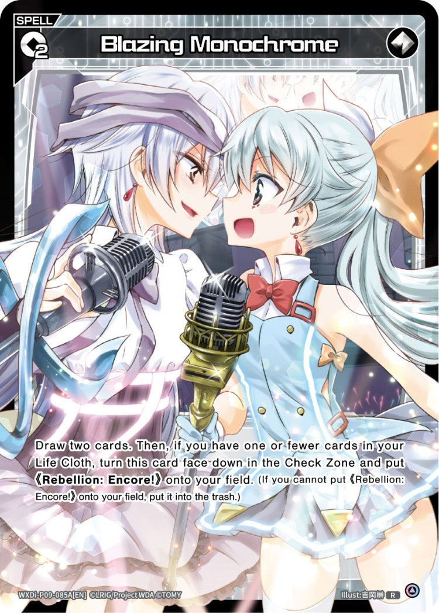

# Blazing Monochrome

## Thông tin lá

| Trường | Giá trị |
| --- | --- |
| Mã in | WXDi-P09-085A[EN] |
| Set | WXDi-P09[EN] |
| Số thứ tự | 085A |
| Loại thẻ | SPELL |
| Vị trí | Main Deck |
| Số bản | — (set booster, không áp dụng) |
| Màu | Không màu |
| Độ hiếm | R,R(P) |
| Minh họa | 吉岡榊 |
| Level | — |
| Limit | — |
| Power | 0 |
| LRIG type / Class | — |
| Team / Master | — |
| Cost | 《C》×２ |
| Grow cost | — |
| Use timing | — |
| Life Burst | Không |

## Card text chính thức

Draw two cards. Then, if you have one or fewer cards in your Life Cloth, turn this card face down in the Check Zone and put 《Rebellion: Encore!》 onto your field. (If you cannot put 《Rebellion: Encore!》 onto your field, put it into the trash.)

## Power text / Life Burst

—

## Ghi chú minh họa
Artist: 吉岡榊. Ảnh R được tải từ Card List tiếng Anh.

## FAQ chính thức

— (không có FAQ riêng cho mã này trên trang FAQ tiếng Anh.)

## Ảnh biến thể

- [R(P)](../images/WXDi-P09-085AP-EN.jpg)

## Nguồn
[Card List/FAQ chính thức](https://www.takaratomy.co.jp/products/en.wixoss/card/card.html?card_no=WXDi-P09-085A%5BEN%5D ) · [Ảnh thẻ](https://www.takaratomy.co.jp/products/en.wixoss/card/thumb/WXDi-P09-085A%5BEN%5D.jpg)
