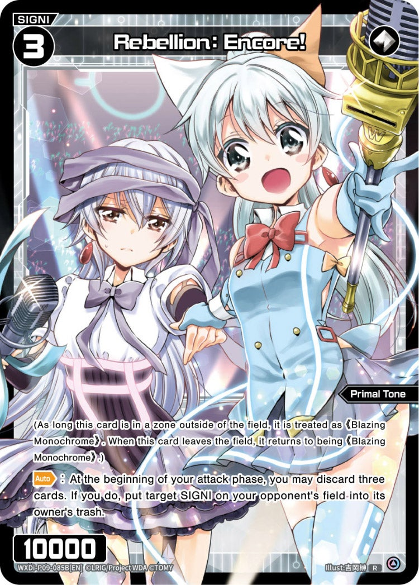

# Rebellion: Encore!

## Thông tin lá

| Trường | Giá trị |
| --- | --- |
| Mã in | WXDi-P09-085B[EN] |
| Set | WXDi-P09[EN] |
| Số thứ tự | 085B |
| Loại thẻ | SIGNI |
| Vị trí | Main Deck |
| Số bản | — (set booster, không áp dụng) |
| Màu | Không màu |
| Độ hiếm | R,R(P) |
| Minh họa | 吉岡榊 |
| Level | 3 |
| Limit | — |
| Power | 10000 |
| LRIG type / Class | Primal Tone |
| Team / Master | — |
| Cost | — |
| Grow cost | — |
| Use timing | — |
| Life Burst | Không |

## Card text chính thức

(As long this card is in a zone outside of the field, it is treated as 《Blazing Monochrome》. When this card leaves the field, it returns to being 《Blazing Monochrome》.)

[Auto]: At the beginning of your attack phase, you may discard three cards. If you do, put target SIGNI on your opponent's field into its owner's trash.

## Power text / Life Burst

—

## Ghi chú minh họa
Artist: 吉岡榊. Ảnh R được tải từ Card List tiếng Anh.

## FAQ chính thức

— (không có FAQ riêng cho mã này trên trang FAQ tiếng Anh.)

## Ảnh biến thể

- [R(P)](../images/WXDi-P09-085BP-EN.jpg)

## Nguồn
[Card List/FAQ chính thức](https://www.takaratomy.co.jp/products/en.wixoss/card/card.html?card_no=WXDi-P09-085B%5BEN%5D ) · [Ảnh thẻ](https://www.takaratomy.co.jp/products/en.wixoss/card/thumb/WXDi-P09-085B%5BEN%5D.jpg)
