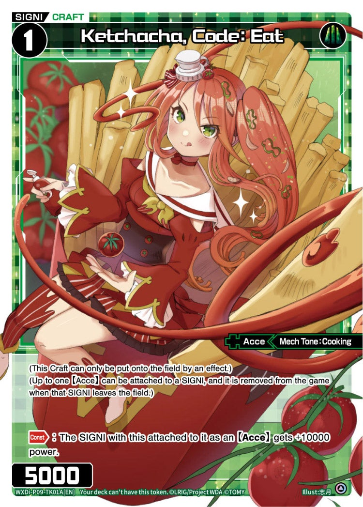

# Ketchacha, Code: Eat

## Thông tin lá

| Trường | Giá trị |
| --- | --- |
| Mã in | WXDi-P09-TK01A[EN] |
| Set | WXDi-P09[EN] |
| Số thứ tự | TK01A |
| Loại thẻ | TOKEN |
| Vị trí | Ngoài deck (token/special) |
| Số bản | — (set booster, không áp dụng) |
| Màu | Xanh lá |
| Độ hiếm | TK |
| Minh họa | 志月 |
| Level | 1 |
| Limit | — |
| Power | 5000 |
| LRIG type / Class | Mech Tone：Cooking |
| Team / Master | — |
| Cost | — |
| Grow cost | — |
| Use timing | — |
| Life Burst | Không |

## Card text chính thức

(This Craft can only be put onto the field by an effect.)
(Up to one 【Acce】 can be attached to a SIGNI, and it is removed from the game when that SIGNI leaves the field.)
『[Constant]: The SIGNI with this attached to it as an 【Acce】 gets +10000 power.』

## Power text / Life Burst

—

## Ghi chú minh họa
Artist: 志月. Ảnh TK được tải từ Card List tiếng Anh.

Đây là lá token/coin/special đi kèm sản phẩm, không phải lá thường trong bộ chính.

## FAQ chính thức

**Q. How should this card be handled?**
A. This is a CRAFT SIGNI that can be added to the LRIG deck through the effect of 《Mel - Cheers》. CRAFT is not treated as cards, so they cannot be targeted by effects that choose cards from the LRIG deck, such as the effect of 《Ril//Memoria, Crimson Warlord》.

## Ảnh biến thể

- [TK](../images/WXDi-P09-TK01AP-EN.jpg)

## Nguồn
[Card List/FAQ chính thức](https://www.takaratomy.co.jp/products/en.wixoss/card/card.html?card_no=WXDi-P09-TK01A%5BEN%5D ) · [Ảnh thẻ](https://www.takaratomy.co.jp/products/en.wixoss/card/thumb/WXDi-P09-TK01A%5BEN%5D.jpg)
