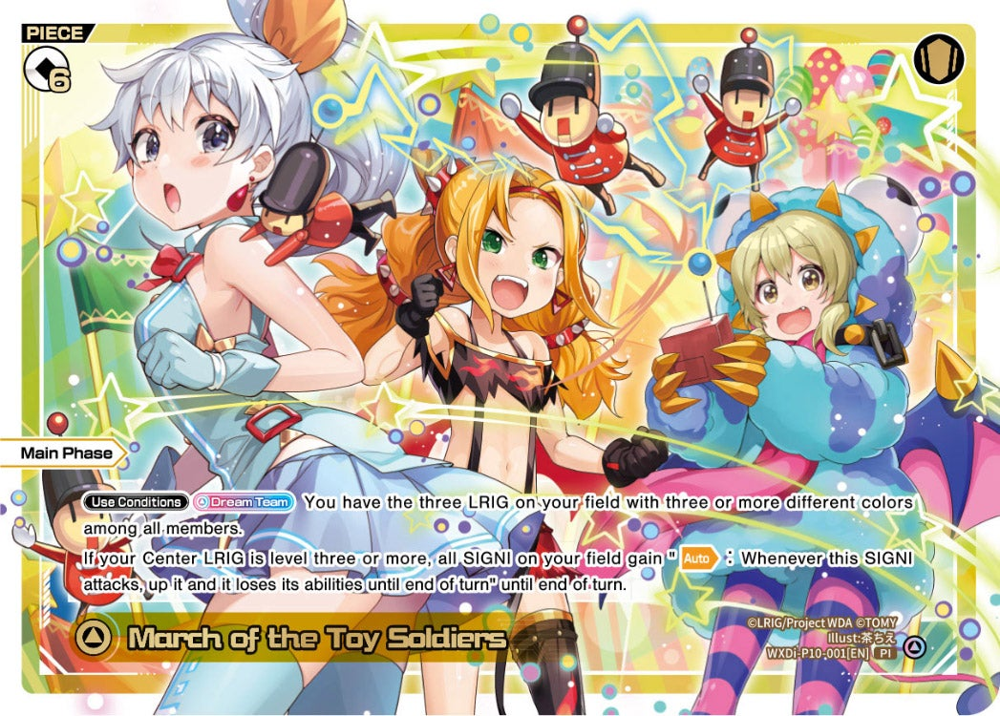

# March of the Toy Soldiers

## Thông tin lá

| Trường | Giá trị |
| --- | --- |
| Mã in | WXDi-P10-001[EN] |
| Set | WXDi-P10[EN] |
| Số thứ tự | 001 |
| Loại thẻ | PIECE |
| Vị trí | LRIG Deck |
| Số bản | — (set booster, không áp dụng) |
| Màu | Trắng |
| Độ hiếm | PI,LRP |
| Minh họa | 茶ちえ |
| Level | — |
| Limit | — |
| Power | 0 |
| LRIG type / Class | — |
| Team / Master | — |
| Cost | 《C》×６ |
| Grow cost | — |
| Use timing | Main Phase |
| Life Burst | Không |

## Card text chính thức

[Use Conditions] [Dream Team] You have the three LRIG on your field with three or more different colors among all members.

If your Center LRIG is level three or more, all SIGNI on your field gain "[Auto]: Whenever this SIGNI attacks, up it and it loses its abilities until end of turn" until end of turn.

## Power text / Life Burst

—

## Ghi chú minh họa
Artist: 茶ちえ. Ảnh PI được tải từ Card List tiếng Anh.

## FAQ chính thức

**Q. I used this PIECE when my center LRIG was level two. May my SIGNI gain the [Auto] ability by the effect of this PIECE when my center LRIG was grow and reaches level three?**
A. No, it cannot gain the [Auto] ability. That effect will only be applicable when your center LRIG is level three or higher when that PIECE is used, and if you use it when your center LRIG is level two or less, the effect will end without anything.

**Q. May my SIGNI that enter the field after using this PIECE gained the [Auto] ability?**
A. No, it cannot gain it. This effect only affects the SIGNI on your field when this PIECE is used.

**Q. If a SIGNI that gained the [Auto] ability by this PIECE also has other [Auto] ability that triggers "Whenever this SIGNI attacks", will that ability trigger?**
A. Yes, it is triggered. Both of those [Auto] abilities are triggered when attacked, and can be resolved in any order. Abilities trigger once, you can resolve it even if the SIGNI is loes its abilities, so you can process the [Auto] ability of "whenever this SIGNI attacks" even if which ability triggered first.

## Ảnh biến thể

- [LRP](../images/WXDi-P10-001P-EN.jpg)

## Nguồn
[Card List/FAQ chính thức](https://www.takaratomy.co.jp/products/en.wixoss/card/card.html?card_no=WXDi-P10-001%5BEN%5D ) · [Ảnh thẻ](https://www.takaratomy.co.jp/products/en.wixoss/card/thumb/WXDi-P10-001%5BEN%5D.jpg)
