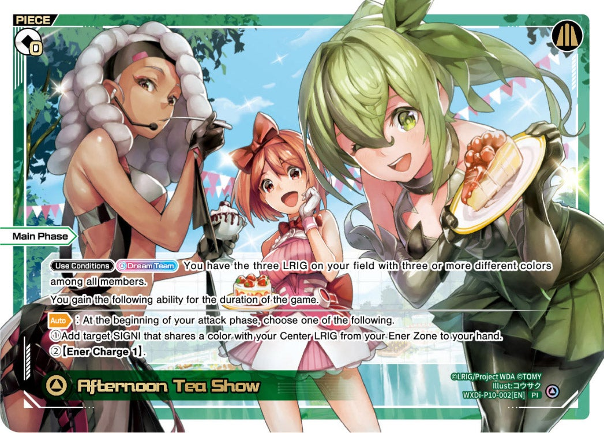

# Afternoon Tea Show

## Thông tin lá

| Trường | Giá trị |
| --- | --- |
| Mã in | WXDi-P10-002[EN] |
| Set | WXDi-P10[EN] |
| Số thứ tự | 002 |
| Loại thẻ | PIECE |
| Vị trí | LRIG Deck |
| Số bản | — (set booster, không áp dụng) |
| Màu | Xanh lá |
| Độ hiếm | PI,LRP |
| Minh họa | コウサク |
| Level | — |
| Limit | — |
| Power | 0 |
| LRIG type / Class | — |
| Team / Master | — |
| Cost | 《C》×０ |
| Grow cost | — |
| Use timing | Main Phase |
| Life Burst | Không |

## Card text chính thức

[Use Conditions] [Dream Team] You have the three LRIG on your field with three or more different colors among all members.

You gain the following ability for the duration of the game.
『[Auto]: At the beginning of your attack phase, choose one of the following.
①Add target SIGNI that shares a color with your Center LRIG from your Ener Zone to your hand.
②【Ener Charge 1】.』

## Power text / Life Burst

—

## Ghi chú minh họa
Artist: コウサク. Ảnh PI được tải từ Card List tiếng Anh.

## FAQ chính thức

**Q. May I add 《Percival, Blessed Crimson General》 with white and red  from my Ener zone to my hand, when my center LRIG si white?**
A. Yes, you can add it to your hand since it has the common color white.

## Ảnh biến thể

- [LRP](../images/WXDi-P10-002P-EN.jpg)

## Nguồn
[Card List/FAQ chính thức](https://www.takaratomy.co.jp/products/en.wixoss/card/card.html?card_no=WXDi-P10-002%5BEN%5D ) · [Ảnh thẻ](https://www.takaratomy.co.jp/products/en.wixoss/card/thumb/WXDi-P10-002%5BEN%5D.jpg)
