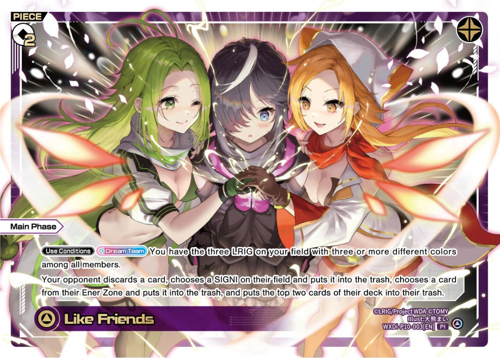

# Like Friends

## Thông tin lá

| Trường | Giá trị |
| --- | --- |
| Mã in | WXDi-P10-003[EN] |
| Set | WXDi-P10[EN] |
| Số thứ tự | 003 |
| Loại thẻ | PIECE |
| Vị trí | LRIG Deck |
| Số bản | — (set booster, không áp dụng) |
| Màu | Đen |
| Độ hiếm | PI,LRP |
| Minh họa | 大熊まい |
| Level | — |
| Limit | — |
| Power | 0 |
| LRIG type / Class | — |
| Team / Master | — |
| Cost | 《C》×２ |
| Grow cost | — |
| Use timing | Main Phase |
| Life Burst | Không |

## Card text chính thức

[Use Conditions] [Dream Team] You have the three LRIG on your field with three or more different colors among all members.

Your opponent discards a card, chooses a SIGNI on their field and puts it into the trash, chooses a card from their Ener Zone and puts it into the trash, and puts the top two cards of their deck into their trash.

## Power text / Life Burst

—

## Ghi chú minh họa
Artist: 大熊まい. Ảnh PI được tải từ Card List tiếng Anh.

## FAQ chính thức

**Q. When I used this PIECE, if my opponent have zero cards in their hand, or no SIGNI on my opponent's field, what happens?**
A. In that case, the part that was zero did not do anything, but resolve the remaining effects.

## Ảnh biến thể

- [LRP](../images/WXDi-P10-003P-EN.jpg)

## Nguồn
[Card List/FAQ chính thức](https://www.takaratomy.co.jp/products/en.wixoss/card/card.html?card_no=WXDi-P10-003%5BEN%5D ) · [Ảnh thẻ](https://www.takaratomy.co.jp/products/en.wixoss/card/thumb/WXDi-P10-003%5BEN%5D.jpg)
