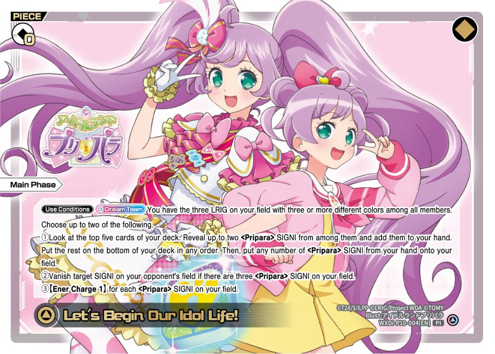

# Let's Begin Our Idol Life!

## Thông tin lá

| Trường | Giá trị |
| --- | --- |
| Mã in | WXDi-P10-004[EN] |
| Set | WXDi-P10[EN] |
| Số thứ tự | 004 |
| Loại thẻ | PIECE |
| Vị trí | LRIG Deck |
| Số bản | — (set booster, không áp dụng) |
| Màu | Không màu |
| Độ hiếm | PI,LRP |
| Minh họa | アイドルランドプリパラ |
| Level | — |
| Limit | — |
| Power | 0 |
| LRIG type / Class | — |
| Team / Master | — |
| Cost | 《C》×０ |
| Grow cost | — |
| Use timing | Main Phase |
| Life Burst | Không |

## Card text chính thức

[Use Conditions] [Dream Team] You have the three LRIG on your field with three or more different colors among all members.

Choose up to two of the following.
①Look at the top five cards of your deck. Reveal up to two <Pripara> SIGNI from among them and add them to your hand. Put the rest on the bottom of your deck in any order. Then, put any number of <Pripara> SIGNI from your hand onto your field.
②Vanish target SIGNI on your opponent's field if there are three <Pripara> SIGNI on your field.
③【Ener Charge 1】 for each <Pripara> SIGNI on your field.

## Power text / Life Burst

—

## Ghi chú minh họa
Artist: アイドルランドプリパラ. Ảnh PI được tải từ Card List tiếng Anh.

## FAQ chính thức

**Q. When there was no SIGNI in my field, I choose (1) and (3) and used this PIECE. May I be able to resolve [Ener charge 1] three times with the effect of (3), if I put three <Pripara> SIGNI onto my field with the effect of (1)?**
A. Yes, you can. Since the effect is processed in order from the top, you can put <Pripara> SIGNI onto your field and then count the number and resolve [Ener charge 1].

## Ảnh biến thể

- [LRP](../images/WXDi-P10-004P-EN.jpg)

## Nguồn
[Card List/FAQ chính thức](https://www.takaratomy.co.jp/products/en.wixoss/card/card.html?card_no=WXDi-P10-004%5BEN%5D ) · [Ảnh thẻ](https://www.takaratomy.co.jp/products/en.wixoss/card/thumb/WXDi-P10-004%5BEN%5D.jpg)
