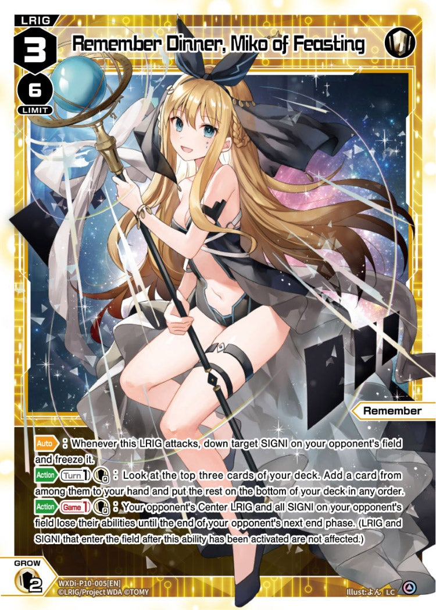

# Remember Dinner, Miko of Feasting

## Thông tin lá

| Trường | Giá trị |
| --- | --- |
| Mã in | WXDi-P10-005[EN] |
| Set | WXDi-P10[EN] |
| Số thứ tự | 005 |
| Loại thẻ | LRIG |
| Vị trí | LRIG Deck |
| Số bản | — (set booster, không áp dụng) |
| Màu | Trắng |
| Độ hiếm | LC,LR,LRP,UR |
| Minh họa | よん |
| Level | 3 |
| Limit | 6 |
| Power | 0 |
| LRIG type / Class | Rememba |
| Team / Master | — |
| Cost | — |
| Grow cost | 《W》×２ |
| Use timing | — |
| Life Burst | Không |

## Card text chính thức

[Auto]: Whenever this LRIG attacks, down target SIGNI on your opponent's field and freeze it.
[Action] {1/Turn} {Whitex0}: Look at the top three cards of your deck. Add a card from among them to your hand and put the rest on the bottom of your deck in any order.
[Action] {1/Game} {Whitex0}: Your opponent's Center LRIG and all SIGNI on your opponent's field lose their abilities until the end of your opponent's next end phase. (LRIG and SIGNI that enter the field after this ability has been activated are not affected.)

## Power text / Life Burst

—

## Ghi chú minh họa
Artist: よん. Ảnh LC được tải từ Card List tiếng Anh.

## FAQ chính thức

**Q. I used the second [Action] ability, then my opponent's center LRIG was lose abilities. What happens if my opponent grows their center LRIG at the next turn?**
A. It is not affected by that effect when enter the field after using this ability, so the new growed center LRIG is not lose abilities.

**Q. I used the second [Action] ability, then my opponent's center LRIG was lose abilities. If those LRIG or SIGNI have [Auto] abilities those triggers "at the end of your turn", will they trigger at the end of my opponent's turn?**
A. No, it will not be triggered. In the end phase, the ability to trigger "at the end of your turn" is triggered and resolved, and after the end of them, the effect of "until the end of your turn" disappears. So when your opponent check whether to trigger or not, your opponent abilities will still be lost.

## Ảnh biến thể

- [LRP](../images/WXDi-P10-005P-EN.jpg)
- [LR](../images/WXDi-P10-005R-EN.jpg)
- [UR](../images/WXDi-P10-005U-EN.jpg)

## Nguồn
[Card List/FAQ chính thức](https://www.takaratomy.co.jp/products/en.wixoss/card/card.html?card_no=WXDi-P10-005%5BEN%5D ) · [Ảnh thẻ](https://www.takaratomy.co.jp/products/en.wixoss/card/thumb/WXDi-P10-005%5BEN%5D.jpg)
