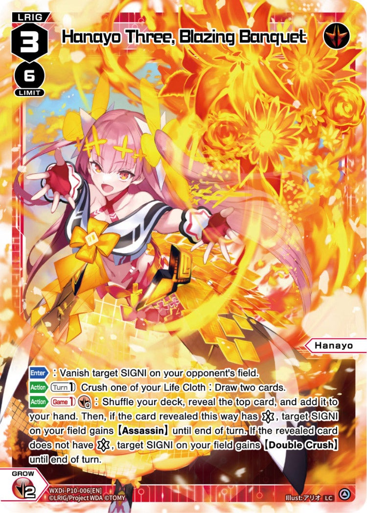

# Hanayo Three, Blazing Banquet

## Thông tin lá

| Trường | Giá trị |
| --- | --- |
| Mã in | WXDi-P10-006[EN] |
| Set | WXDi-P10[EN] |
| Số thứ tự | 006 |
| Loại thẻ | LRIG |
| Vị trí | LRIG Deck |
| Số bản | — (set booster, không áp dụng) |
| Màu | Đỏ |
| Độ hiếm | LC,LR,LRP,UR |
| Minh họa | アリオ |
| Level | 3 |
| Limit | 6 |
| Power | 0 |
| LRIG type / Class | Hanayo |
| Team / Master | — |
| Cost | — |
| Grow cost | 《R》×２ |
| Use timing | — |
| Life Burst | Không |

## Card text chính thức

[Enter]: Vanish target SIGNI on your opponent's field.
[Action] {1/Turn} Crush one of your Life Cloth: Draw two cards.
[Action] {1/Game} {Redx0}: Shuffle your deck, reveal the top card, and add it to your hand. Then, if the card revealed this way has 【Life Burst】, target SIGNI on your field gains 【Assassin】 until end of turn. If the revealed card does not have 【Life Burst】, target SIGNI on your field gains 【Double Crush】 until end of turn.

## Power text / Life Burst

—

## Ghi chú minh họa
Artist: アリオ. Ảnh LC được tải từ Card List tiếng Anh.

## FAQ chính thức

**Q. Does the [Enter] ability have to be triggered?**
A. Yes, the [Enter] ability without cost is must triggered. If there are SIGNI on your opponent's field and you can choose one of them, you must target them and resolve the effect.

**Q. May I crush my opponent's Life Cloth with this card's first [Action] ability?**
A. No, you cannot. If you want to move a card at the cost of the ability, it refers only to your own card if there is no descritption.

**Q. If I crush my Life Cloth with the first [Action] ability and crushed card is Life Burst, will my Life Burst be triggered?**
A. Yes, it is triggered. After drawing two cards with this effect of the first [Action] ability, you can resolve your Life Burst.

**Q. May I use the first [Action] ability when my Life Cloth is zero?**
A. No, if you have no Life Cloth, the cost cannot be paid and the first [Action] ability cannot be used.

**Q. May I choose my SIGNI after revealing the card on my deck when I used the second [Action] ability?**
A. Yes, in that ability, target your SIGNI after revealing the top of your deck and added it to your hand.

## Ảnh biến thể

- [LRP](../images/WXDi-P10-006P-EN.jpg)
- [LR](../images/WXDi-P10-006R-EN.jpg)
- [UR](../images/WXDi-P10-006U-EN.jpg)

## Nguồn
[Card List/FAQ chính thức](https://www.takaratomy.co.jp/products/en.wixoss/card/card.html?card_no=WXDi-P10-006%5BEN%5D ) · [Ảnh thẻ](https://www.takaratomy.co.jp/products/en.wixoss/card/thumb/WXDi-P10-006%5BEN%5D.jpg)
