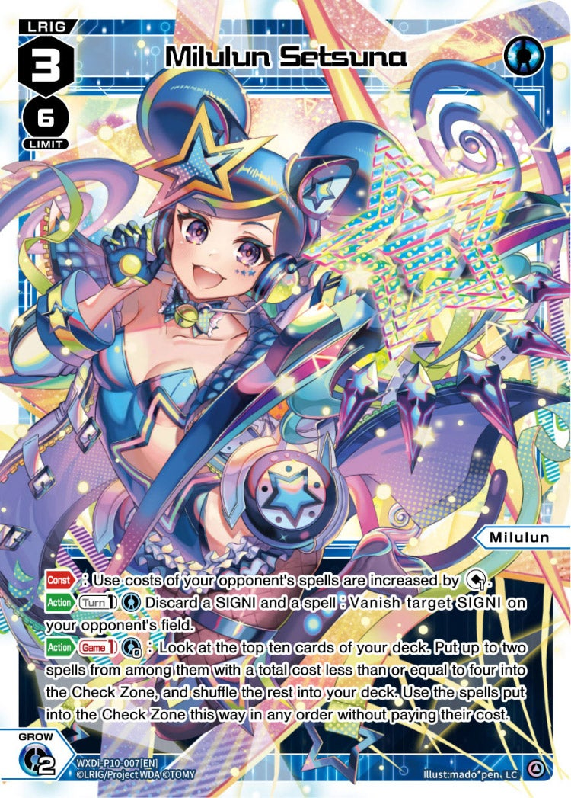

# Milulun Setsuna

## Thông tin lá

| Trường | Giá trị |
| --- | --- |
| Mã in | WXDi-P10-007[EN] |
| Set | WXDi-P10[EN] |
| Số thứ tự | 007 |
| Loại thẻ | LRIG |
| Vị trí | LRIG Deck |
| Số bản | — (set booster, không áp dụng) |
| Màu | Xanh dương |
| Độ hiếm | LC,LR,LRP,UR |
| Minh họa | mado*pen |
| Level | 3 |
| Limit | 6 |
| Power | 0 |
| LRIG type / Class | Milulun |
| Team / Master | — |
| Cost | — |
| Grow cost | 《U》×２ |
| Use timing | — |
| Life Burst | Không |

## Card text chính thức

[Constant]: Use costs of your opponent's spells are increased by {Colorlessx1}.
[Action] {1/Turn} {Blue} Discard a SIGNI and a spell: Vanish target SIGNI on your opponent's field.
[Action] {1/Game} {Bluex0}: Look at the top ten cards of your deck. Put up to two spells from among them with a total cost less than or equal to four into the Check Zone, and shuffle the rest into your deck. Use the spells put into the Check Zone this way in any order without paying their cost.

## Power text / Life Burst

—

## Ghi chú minh họa
Artist: mado*pen. Ảnh LC được tải từ Card List tiếng Anh.

## FAQ chính thức

**Q. Does my opponent need to pay {colorless} by this card's [Const] ability when my opponent triggers Life Burst of a spell?**
A. No, triggering of Life Burst is distinguished from the use of spells. The triggering of spell's Life Burst is not the use of a spell, so your opponent not have to pay {colorless}.

**Q. If I used two spells by the second [Action] ability, may my opponent use [Spell Cut-in] in each spell?**
A. Yes, your opponent can use [Spell Cut-in] for each spell.

**Q. I put two spells into the Check Zone by this card's seconed [Action]. As I use the first spell, my opponent used (1) of 《ロック・ユアハート》 with [Spell Cut-in]. When I use the second spell, what happens to payment of {colorless} {colorless} {colorless}?**
A. The effect of 《Milulun Setsuna》 is "Use the spells put into the Check Zone this way in any order without paying their cost.". You can choose whether to use the spell or not to use it or not to pay cost. So you may choose pay {colorless} {colorless} {colorless} to use the spell or not to use it. If you not use the spell, the spell remain in the Check Zone and will be put into the your trash as a process at the end of the turn.

## Ảnh biến thể

- [LRP](../images/WXDi-P10-007P-EN.jpg)
- [LR](../images/WXDi-P10-007R-EN.jpg)
- [UR](../images/WXDi-P10-007U-EN.jpg)

## Nguồn
[Card List/FAQ chính thức](https://www.takaratomy.co.jp/products/en.wixoss/card/card.html?card_no=WXDi-P10-007%5BEN%5D ) · [Ảnh thẻ](https://www.takaratomy.co.jp/products/en.wixoss/card/thumb/WXDi-P10-007%5BEN%5D.jpg)
