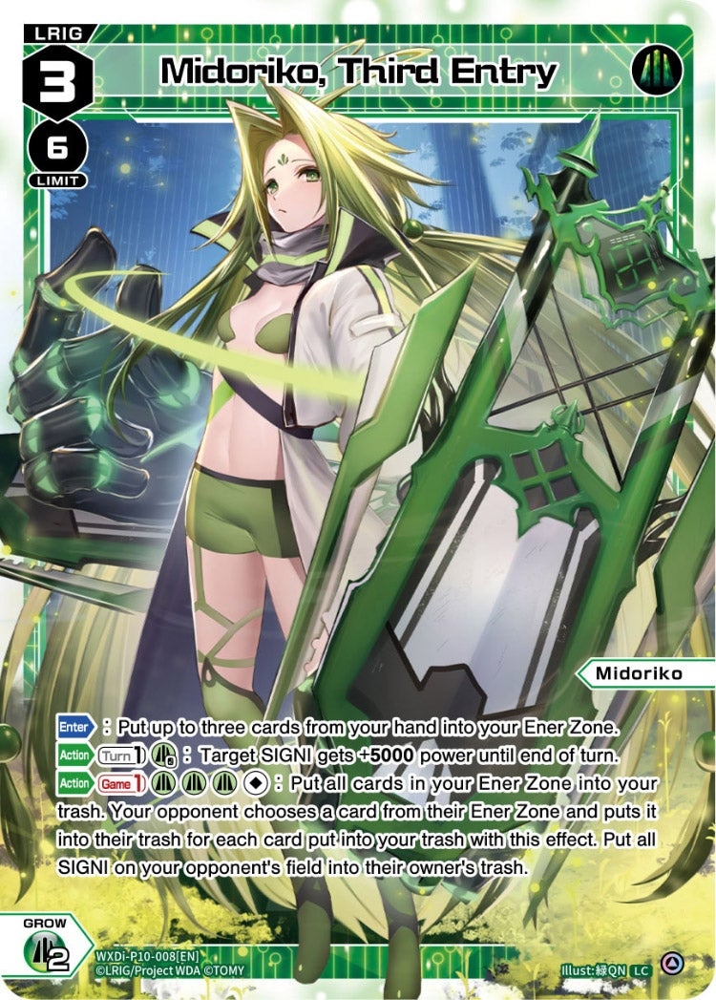

# Midoriko, Third Entry

## Thông tin lá

| Trường | Giá trị |
| --- | --- |
| Mã in | WXDi-P10-008[EN] |
| Set | WXDi-P10[EN] |
| Số thứ tự | 008 |
| Loại thẻ | LRIG |
| Vị trí | LRIG Deck |
| Số bản | — (set booster, không áp dụng) |
| Màu | Xanh lá |
| Độ hiếm | LC,LR,LRP,UR |
| Minh họa | 緑QN |
| Level | 3 |
| Limit | 6 |
| Power | 0 |
| LRIG type / Class | Midoriko |
| Team / Master | — |
| Cost | — |
| Grow cost | 《G》×２ |
| Use timing | — |
| Life Burst | Không |

## Card text chính thức

[Enter]: Put up to three cards from your hand into your Ener Zone.
[Action] {1/Turn} {Greenx0}: Target SIGNI gets +5000 power until end of turn.
[Action] {1/Game} {Green} {Green} {Green} {Colorless}: Put all cards in your Ener Zone into your trash. Your opponent chooses a card from their Ener Zone and puts it into their trash for each card put into your trash with this effect. Put all SIGNI on your opponent's field into their owner's trash.

## Power text / Life Burst

—

## Ghi chú minh họa
Artist: 緑QN. Ảnh LC được tải từ Card List tiếng Anh.

## FAQ chính thức

**Q. May I target my opponent's SIGNI by the first [Action] ability?**
A. Yes, you can also target your opponent's SIGNI and it gets +5000 power.

**Q. Do I count the {Green} {Green} {Green} {Colorless}, which I paid for the second [Action] ability of "each card put into your trash with this effect."?**
A. No, you don't count. Its effect doesn't count paid cost number of the second [Action] ability. It only count number of the effect with "Put all cards in your Ener Zone into your trash.".

**Q. Does the the second [Action] ability have to be put all cards in my Ener Zone into my trash?**
A. Yes, it must to do. Even if your opponent doesn't have any cards in their Ener Zone, your all cards in your Ener Zone will be put into  your trash.

## Ảnh biến thể

- [LRP](../images/WXDi-P10-008P-EN.jpg)
- [LR](../images/WXDi-P10-008R-EN.jpg)
- [UR](../images/WXDi-P10-008U-EN.jpg)

## Nguồn
[Card List/FAQ chính thức](https://www.takaratomy.co.jp/products/en.wixoss/card/card.html?card_no=WXDi-P10-008%5BEN%5D ) · [Ảnh thẻ](https://www.takaratomy.co.jp/products/en.wixoss/card/thumb/WXDi-P10-008%5BEN%5D.jpg)
