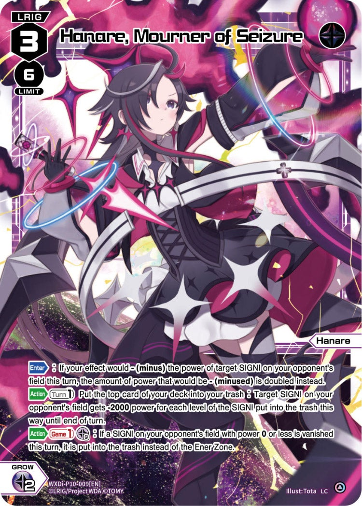

# Hanare, Mourner of Seizure

## Thông tin lá

| Trường | Giá trị |
| --- | --- |
| Mã in | WXDi-P10-009[EN] |
| Set | WXDi-P10[EN] |
| Số thứ tự | 009 |
| Loại thẻ | LRIG |
| Vị trí | LRIG Deck |
| Số bản | — (set booster, không áp dụng) |
| Màu | Đen |
| Độ hiếm | LC,LR,LRP,UR |
| Minh họa | Tota |
| Level | 3 |
| Limit | 6 |
| Power | 0 |
| LRIG type / Class | Hanare |
| Team / Master | — |
| Cost | — |
| Grow cost | 《B》×２ |
| Use timing | — |
| Life Burst | Không |

## Card text chính thức

[Enter]: If your effect would - (minus) the power of target SIGNI on your opponent's field this turn, the amount of power that would be - (minused) is doubled instead.
[Action] {1/Turn} Put the top card of your deck into your trash: Target SIGNI on your opponent's field gets -2000 power for each level of the SIGNI put into the trash this way until end of turn.
[Action] {1/Game} {Blackx0}: If a SIGNI on your opponent's field with power 0 or less is vanished this turn, it is put into the trash instead of the Ener Zone.

## Power text / Life Burst

—

## Ghi chú minh họa
Artist: Tota. Ảnh LC được tải từ Card List tiếng Anh.

## FAQ chính thức

**Q. May I choose my opponent's SIGNI after I put the top card of my deck into my trash when I used the first [Action] ability?**
A. Yes, in that ability, target your opponent's SIGNI after put the top card of your deck into your trash.

**Q. What happens if I put a spell from the top card of my deck into my trash with the first [Action] ability?**
A. Even in that case, you target SIGNI from your opponent's SIGNI, but the power cannot be negative.

**Q. There is 《Remember//Memoria, Code: Heart》 on the my opponent's field, and the cost of using my center LRIG's [Action] abilities is increasing {colorless}.If I use the first [Action] ability, which "put into the trash this way" is referred to?**
A. In that case, it will be the card placed in your trash from the top of your deck.

## Ảnh biến thể

- [LRP](../images/WXDi-P10-009P-EN.jpg)
- [LR](../images/WXDi-P10-009R-EN.jpg)
- [UR](../images/WXDi-P10-009U-EN.jpg)

## Nguồn
[Card List/FAQ chính thức](https://www.takaratomy.co.jp/products/en.wixoss/card/card.html?card_no=WXDi-P10-009%5BEN%5D ) · [Ảnh thẻ](https://www.takaratomy.co.jp/products/en.wixoss/card/thumb/WXDi-P10-009%5BEN%5D.jpg)
