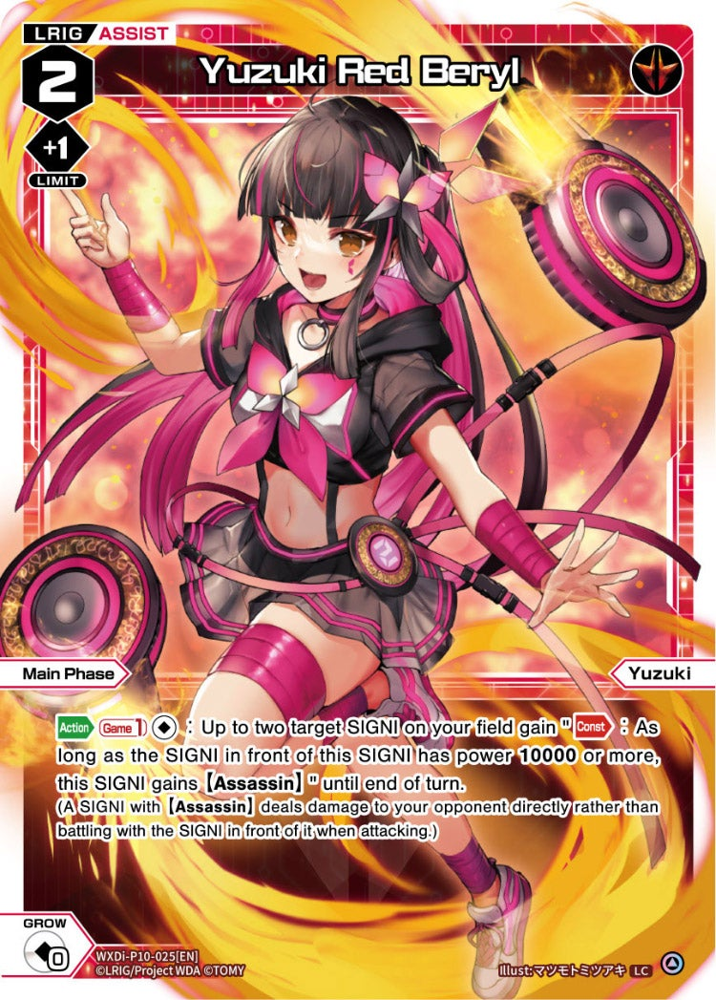

# Yuzuki Red Beryl

## Thông tin lá

| Trường | Giá trị |
| --- | --- |
| Mã in | WXDi-P10-025[EN] |
| Set | WXDi-P10[EN] |
| Số thứ tự | 025 |
| Loại thẻ | ASSIST LRIG |
| Vị trí | LRIG Deck |
| Số bản | — (set booster, không áp dụng) |
| Màu | Đỏ |
| Độ hiếm | LC,LC(P) |
| Minh họa | マツモトミツアキ |
| Level | 2 |
| Limit | ＋１ |
| Power | 0 |
| LRIG type / Class | Yuzuki |
| Team / Master | — |
| Cost | — |
| Grow cost | 《C》×０ |
| Use timing | Main Phase |
| Life Burst | Không |

## Card text chính thức

[Action] {1/Game} {Colorless}: Up to two target SIGNI on your field gain "[Constant]: As long as the SIGNI in front of this SIGNI has power 10000 or more, this SIGNI gains 【Assassin】" until end of turn.
(A SIGNI with 【Assassin】 deals damage to your opponent directly rather than battling with the SIGNI in front of it when attacking.)

## Power text / Life Burst

—

## Ghi chú minh họa
Artist: マツモトミツアキ. Ảnh LC được tải từ Card List tiếng Anh.

## FAQ chính thức

— (không có FAQ riêng cho mã này trên trang FAQ tiếng Anh.)

## Ảnh biến thể

- [LC(P)](../images/WXDi-P10-025P-EN.jpg)

## Nguồn
[Card List/FAQ chính thức](https://www.takaratomy.co.jp/products/en.wixoss/card/card.html?card_no=WXDi-P10-025%5BEN%5D ) · [Ảnh thẻ](https://www.takaratomy.co.jp/products/en.wixoss/card/thumb/WXDi-P10-025%5BEN%5D.jpg)
