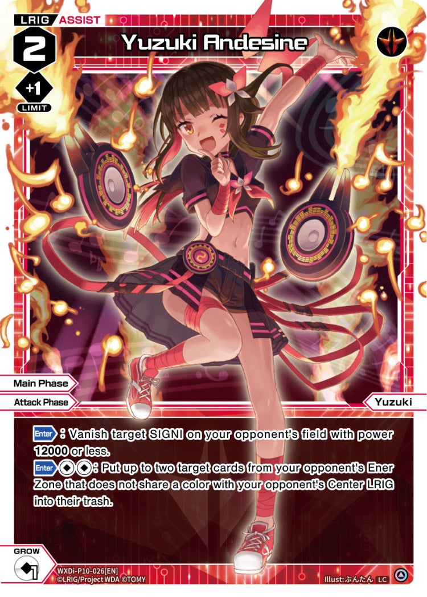

# Yuzuki Andesine

## Thông tin lá

| Trường | Giá trị |
| --- | --- |
| Mã in | WXDi-P10-026[EN] |
| Set | WXDi-P10[EN] |
| Số thứ tự | 026 |
| Loại thẻ | ASSIST LRIG |
| Vị trí | LRIG Deck |
| Số bản | — (set booster, không áp dụng) |
| Màu | Đỏ |
| Độ hiếm | LC,LC(P) |
| Minh họa | ぶんたん |
| Level | 2 |
| Limit | ＋１ |
| Power | 0 |
| LRIG type / Class | Yuzuki |
| Team / Master | — |
| Cost | — |
| Grow cost | 《C》×１ |
| Use timing | Main Phase
Attack Phase |
| Life Burst | Không |

## Card text chính thức

[Enter]: Vanish target SIGNI on your opponent's field with power 12000 or less.
[Enter] {Colorless} {Colorless}: Put up to two target cards from your opponent's Ener Zone that does not share a color with your opponent's Center LRIG into their trash.

## Power text / Life Burst

—

## Ghi chú minh họa
Artist: ぶんたん. Ảnh LC được tải từ Card List tiếng Anh.

## FAQ chính thức

**Q. Does the [Enter] ability have to be triggered?**
A. Yes, the [Enter] ability without cost must be triggered. For example, when it was triggered the first [Enter] ability, if there is SIGNI that you can target on your opponent's field, you must vanish one of them as target.

**Q. May I proccese the second [Enter] ability to put a card in my opponent Ener zone to their trash after I resolve first the first [Enter] ability?**
A. Yes, Both of those [Enter] abilities can be resolved in any order, and it is possible to target someone at the time of triggering of the ability. So it is possible to do if the SIGNI is suitable for the conditions of each ability.

## Ảnh biến thể

- [LC(P)](../images/WXDi-P10-026P-EN.jpg)

## Nguồn
[Card List/FAQ chính thức](https://www.takaratomy.co.jp/products/en.wixoss/card/card.html?card_no=WXDi-P10-026%5BEN%5D ) · [Ảnh thẻ](https://www.takaratomy.co.jp/products/en.wixoss/card/thumb/WXDi-P10-026%5BEN%5D.jpg)
