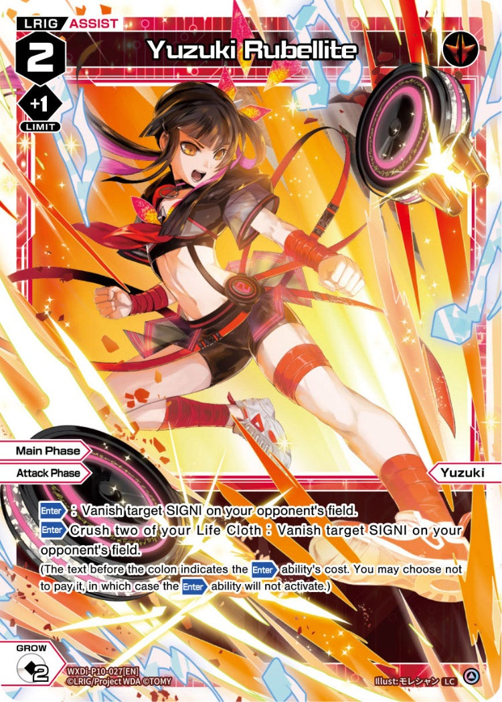

# Yuzuki Rubellite

## Thông tin lá

| Trường | Giá trị |
| --- | --- |
| Mã in | WXDi-P10-027[EN] |
| Set | WXDi-P10[EN] |
| Số thứ tự | 027 |
| Loại thẻ | ASSIST LRIG |
| Vị trí | LRIG Deck |
| Số bản | — (set booster, không áp dụng) |
| Màu | Đỏ |
| Độ hiếm | LC,LC(P) |
| Minh họa | モレシャン |
| Level | 2 |
| Limit | ＋１ |
| Power | 0 |
| LRIG type / Class | Yuzuki |
| Team / Master | — |
| Cost | — |
| Grow cost | 《C》×２ |
| Use timing | Main Phase / Attack Phase |
| Life Burst | Không |

## Card text chính thức

[Enter]: Vanish target SIGNI on your opponent's field.
[Enter] Crush two of your Life Cloth: Vanish target SIGNI on your opponent's field.
(The text before the colon indicates the [Enter] ability's cost. You may choose not to pay it, in which case the [Enter] ability will not activate.)

## Power text / Life Burst

—

## Ghi chú minh họa
Artist: モレシャン. Ảnh LC được tải từ Card List tiếng Anh.

## FAQ chính thức

**Q. May I crush my opponent's Life Cloth with this card's second [Enter] ability?**
A. No, you cannot. If you want to move a card at the cost of the ability, it refers only to your own card if there is no descritption.

**Q. If I crush my Life Cloth with the second [Enter] ability and crushed card is Life Burst, will my Life Burst be triggered?**
A. Yes, it is triggered. After vanish target your opponent's SIGNI with this effect of the second [Enter] ability, you can resolve my Life Burst. (If both cards have Life Burst, you can resolve them in any order.)

**Q. May I use the second [Enter] ability when my Life Cloth are one or less?**
A. No, if you have no Life Cloth, the cost cannot be paid and the second [Enter] ability cannot be used.

## Ảnh biến thể

- [LC(P)](../images/WXDi-P10-027P-EN.jpg)

## Nguồn
[Card List/FAQ chính thức](https://www.takaratomy.co.jp/products/en.wixoss/card/card.html?card_no=WXDi-P10-027%5BEN%5D ) · [Ảnh thẻ](https://www.takaratomy.co.jp/products/en.wixoss/card/thumb/WXDi-P10-027%5BEN%5D.jpg)
