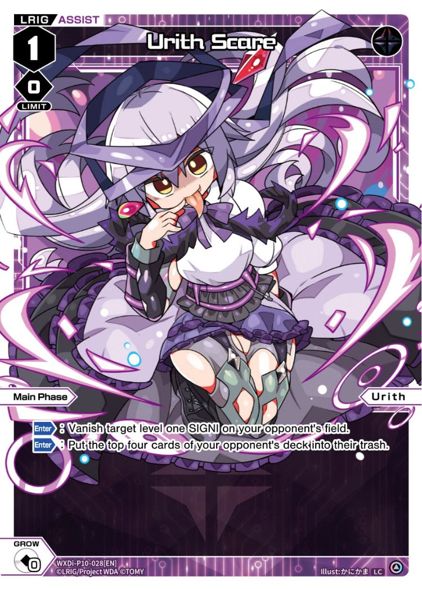

# Urith Scare

## Thông tin lá

| Trường | Giá trị |
| --- | --- |
| Mã in | WXDi-P10-028[EN] |
| Set | WXDi-P10[EN] |
| Số thứ tự | 028 |
| Loại thẻ | ASSIST LRIG |
| Vị trí | LRIG Deck |
| Số bản | — (set booster, không áp dụng) |
| Màu | Đen |
| Độ hiếm | LC,LC(P) |
| Minh họa | かにかま |
| Level | 1 |
| Limit | 0 |
| Power | 0 |
| LRIG type / Class | Urith |
| Team / Master | — |
| Cost | — |
| Grow cost | 《C》×０ |
| Use timing | Main Phase |
| Life Burst | Không |

## Card text chính thức

[Enter]: Vanish target level one SIGNI on your opponent's field.
[Enter]: Put the top four cards of your opponent's deck into their trash.

## Power text / Life Burst

—

## Ghi chú minh họa
Artist: かにかま. Ảnh LC được tải từ Card List tiếng Anh.

## FAQ chính thức

**Q. Does the [Enter] ability have to be triggered?**
A. Yes, the [Enter] ability without cost must be triggered. For example, when it was triggered the first [Enter] ability, if there is SIGNI that you can target on your opponent's field, you must vanish one of them as target.

## Ảnh biến thể

- [LC(P)](../images/WXDi-P10-028P-EN.jpg)

## Nguồn
[Card List/FAQ chính thức](https://www.takaratomy.co.jp/products/en.wixoss/card/card.html?card_no=WXDi-P10-028%5BEN%5D ) · [Ảnh thẻ](https://www.takaratomy.co.jp/products/en.wixoss/card/thumb/WXDi-P10-028%5BEN%5D.jpg)
