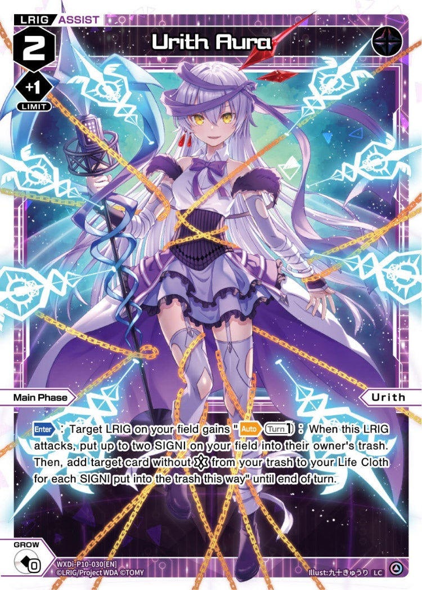

# Urith Aura

## Thông tin lá

| Trường | Giá trị |
| --- | --- |
| Mã in | WXDi-P10-030[EN] |
| Set | WXDi-P10[EN] |
| Số thứ tự | 030 |
| Loại thẻ | ASSIST LRIG |
| Vị trí | LRIG Deck |
| Số bản | — (set booster, không áp dụng) |
| Màu | Đen |
| Độ hiếm | LC,LC(P) |
| Minh họa | 九十きゅうり |
| Level | 2 |
| Limit | ＋１ |
| Power | 0 |
| LRIG type / Class | Urith |
| Team / Master | — |
| Cost | — |
| Grow cost | 《C》×０ |
| Use timing | Main Phase |
| Life Burst | Không |

## Card text chính thức

[Enter]: Target LRIG on your field gains "[Auto] {1/Turn}: When this LRIG attacks, put up to two SIGNI on your field into their owner's trash. Then, add target card without 【Life Burst】 from your trash to your Life Cloth for each SIGNI put into the trash this way" until end of turn.

## Power text / Life Burst

—

## Ghi chú minh họa
Artist: 九十きゅうり. Ảnh LC được tải từ Card List tiếng Anh.

## FAQ chính thức

**Q. What is the order in which the cards are placed when I add two cards from my trash to my Life Cloth?**
A. Decide the order you are using this ability. At that time, you do not need to tell your opponent which one is the top of your Life Cloth.

**Q. If you put SIGNI with [Rise] (one SIGNI underneath it) and nomal SIGNI into my trash by the [Auto] ability, may I add three cards to my Life Cloth because I put three cards into my trash?**
A. No, you can add two cards. Cards placed underneath SIGNI with [Rise] etc. are not put into your trash by that [Auto] ability at the same time, but theu are put into your trash by the (6) of Rule-based action.

## Ảnh biến thể

- [LC(P)](../images/WXDi-P10-030P-EN.jpg)

## Nguồn
[Card List/FAQ chính thức](https://www.takaratomy.co.jp/products/en.wixoss/card/card.html?card_no=WXDi-P10-030%5BEN%5D ) · [Ảnh thẻ](https://www.takaratomy.co.jp/products/en.wixoss/card/thumb/WXDi-P10-030%5BEN%5D.jpg)
