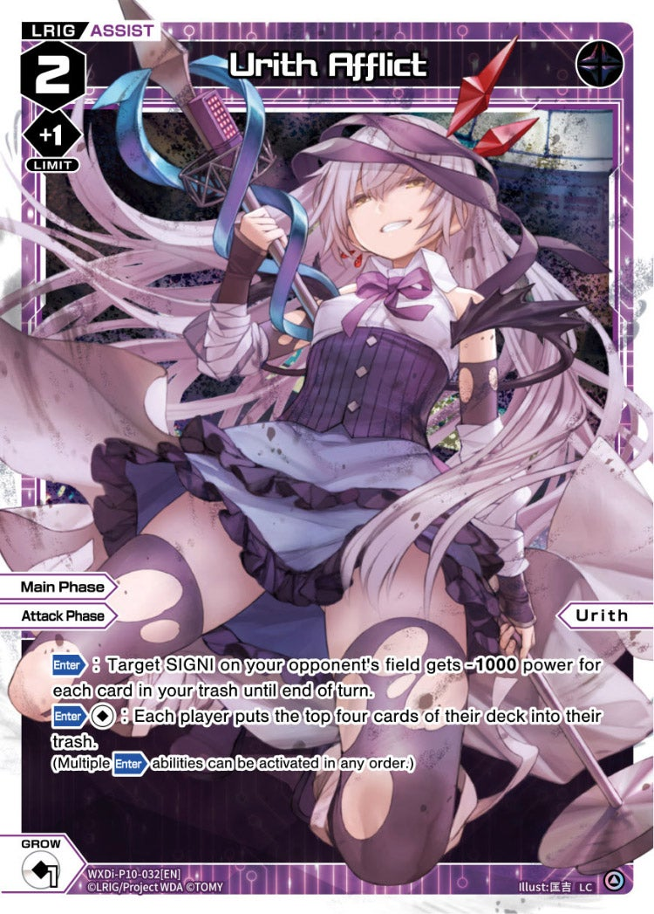

# Urith Afflict

## Thông tin lá

| Trường | Giá trị |
| --- | --- |
| Mã in | WXDi-P10-032[EN] |
| Set | WXDi-P10[EN] |
| Số thứ tự | 032 |
| Loại thẻ | ASSIST LRIG |
| Vị trí | LRIG Deck |
| Số bản | — (set booster, không áp dụng) |
| Màu | Đen |
| Độ hiếm | LC,LC(P) |
| Minh họa | 匡吉 |
| Level | 2 |
| Limit | ＋１ |
| Power | 0 |
| LRIG type / Class | Urith |
| Team / Master | — |
| Cost | — |
| Grow cost | 《C》×１ |
| Use timing | Main Phase / Attack Phase |
| Life Burst | Không |

## Card text chính thức

[Enter]: Target SIGNI on your opponent's field gets -1000 power for each card in your trash until end of turn.
[Enter] {Colorless}: Each player puts the top four cards of their deck into their trash.
(Multiple [Enter] abilities can be activated in any order.)

## Power text / Life Burst

—

## Ghi chú minh họa
Artist: 匡吉. Ảnh LC được tải từ Card List tiếng Anh.

## FAQ chính thức

**Q. May I resolve the first [Enter] ability after I resolved the second [Enter] ability?**
A. Yes, Both of those [Enter] abilities can be resolved in any order.

## Ảnh biến thể

- [LC(P)](../images/WXDi-P10-032P-EN.jpg)

## Nguồn
[Card List/FAQ chính thức](https://www.takaratomy.co.jp/products/en.wixoss/card/card.html?card_no=WXDi-P10-032%5BEN%5D ) · [Ảnh thẻ](https://www.takaratomy.co.jp/products/en.wixoss/card/thumb/WXDi-P10-032%5BEN%5D.jpg)
