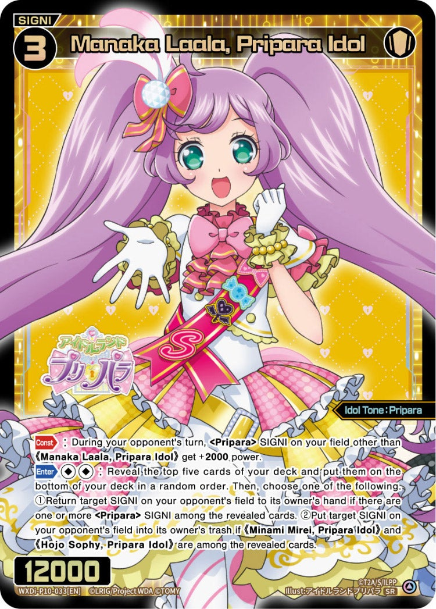

# Manaka Laala, Pripara Idol

## Thông tin lá

| Trường | Giá trị |
| --- | --- |
| Mã in | WXDi-P10-033[EN] |
| Set | WXDi-P10[EN] |
| Số thứ tự | 033 |
| Loại thẻ | SIGNI |
| Vị trí | Main Deck |
| Số bản | — (set booster, không áp dụng) |
| Màu | Trắng |
| Độ hiếm | SR,SRP |
| Minh họa | アイドルランドプリパラ |
| Level | 3 |
| Limit | — |
| Power | 12000 |
| LRIG type / Class | Idol Tone：Pripara |
| Team / Master | — |
| Cost | — |
| Grow cost | — |
| Use timing | — |
| Life Burst | Không |

## Card text chính thức

[Constant]: During your opponent's turn, <Pripara> SIGNI on your field other than 《Manaka Laala, Pripara Idol》 get +2000 power.
[Enter] {Colorless} {Colorless}: Reveal the top five cards of your deck and put them on the bottom of your deck in a random order. Then, choose one of the following. ①Return target SIGNI on your opponent's field to its owner's hand if there are one or more <Pripara> SIGNI among the revealed cards. ②Put target SIGNI on your opponent's field into its owner's trash if 《Minami Mirei, Pripara Idol》 and 《Hojo Sophy, Pripara Idol》 are among the revealed cards.

## Power text / Life Burst

—

## Ghi chú minh họa
Artist: アイドルランドプリパラ. Ảnh SR được tải từ Card List tiếng Anh.

## FAQ chính thức

**Q. If there are two 《Manaka Laala, Pripara Idol》" in my field, will the power of those SIGNI be always get power with their [Const] abilities?**
A. No, it will not get. The power of the SIGNI named 《Manaka Laala, Pripara Idol》 cannnot be gotten with that [Const] ability.

**Q. At the time of the [Enter] ability, may I choose target my opponent's SIGNI after I revealed the top of my deck and check it?**
A. Yes, this ability targets SIGNI only after the card is revealed and placed on the bottom of the deck.

## Ảnh biến thể

- [SRP](../images/WXDi-P10-033P-EN.jpg)

## Nguồn
[Card List/FAQ chính thức](https://www.takaratomy.co.jp/products/en.wixoss/card/card.html?card_no=WXDi-P10-033%5BEN%5D ) · [Ảnh thẻ](https://www.takaratomy.co.jp/products/en.wixoss/card/thumb/WXDi-P10-033%5BEN%5D.jpg)
