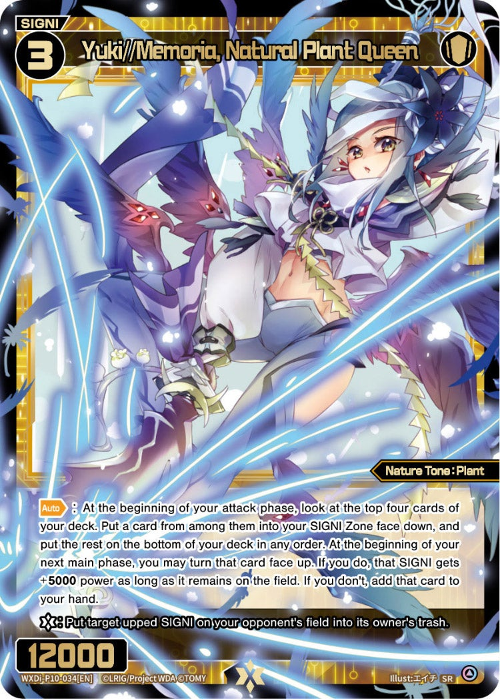

# Yuki//Memoria, Natural Plant Queen

## Thông tin lá

| Trường | Giá trị |
| --- | --- |
| Mã in | WXDi-P10-034[EN] |
| Set | WXDi-P10[EN] |
| Số thứ tự | 034 |
| Loại thẻ | SIGNI |
| Vị trí | Main Deck |
| Số bản | — (set booster, không áp dụng) |
| Màu | Trắng |
| Độ hiếm | SR,SRP |
| Minh họa | エイチ |
| Level | 3 |
| Limit | — |
| Power | 12000 |
| LRIG type / Class | Nature Tone：Plant |
| Team / Master | — |
| Cost | — |
| Grow cost | — |
| Use timing | — |
| Life Burst | Có |

## Card text chính thức

[Auto]: At the beginning of your attack phase, look at the top four cards of your deck. Put a card from among them into your SIGNI Zone face down, and put the rest on the bottom of your deck in any order. At the beginning of your next main phase, you may turn that card face up. If you do, that SIGNI gets +5000 power as long as it remains on the field. If you don't, add that card to your hand.

## Power text / Life Burst

Put target upped SIGNI on your opponent's field into its owner's trash.

## Ghi chú minh họa
Artist: エイチ. Ảnh SR được tải từ Card List tiếng Anh.

## FAQ chính thức

**Q. May I put a spell face down on my SIGNI zone by this [Auto] ability?**
A. Yes, you can. If you turn that card face up at the next your main phase, spells will not be in the SIGNI zone, so it will be put into your trash. If you do not face it up, you can add it to your hand.

**Q. May I put a spell face down on my SIGNI zone by this [Auto] ability it that SIGNI zone already has SIGNI?**
A. Yes, you can. If you still have a SIGNI that on your SIGNI zone at the next your main phase, it will exceed the upper limit of the SIGNI that can be placed in one SIGNI zone, so you will put either into your trash by the Rule-based Action.

**Q. When my 《Yuki//Memoria, Natural Plant Queen》 leaves my field after I put a card face down on my SIGNI zone, what happens at the next my main phase?**
A. Even if 《Yuki//Memoria, Natural Plant Queen》 with triggered the [Auto] ability was left on the field, its ability will tirgger at the next your main phase and you can resolve it. It is same if 《Yuki//Memoria, Natural Plant Queen》 lose its abilities.

## Ảnh biến thể

- [SRP](../images/WXDi-P10-034P-EN.jpg)

## Nguồn
[Card List/FAQ chính thức](https://www.takaratomy.co.jp/products/en.wixoss/card/card.html?card_no=WXDi-P10-034%5BEN%5D ) · [Ảnh thẻ](https://www.takaratomy.co.jp/products/en.wixoss/card/thumb/WXDi-P10-034%5BEN%5D.jpg)
