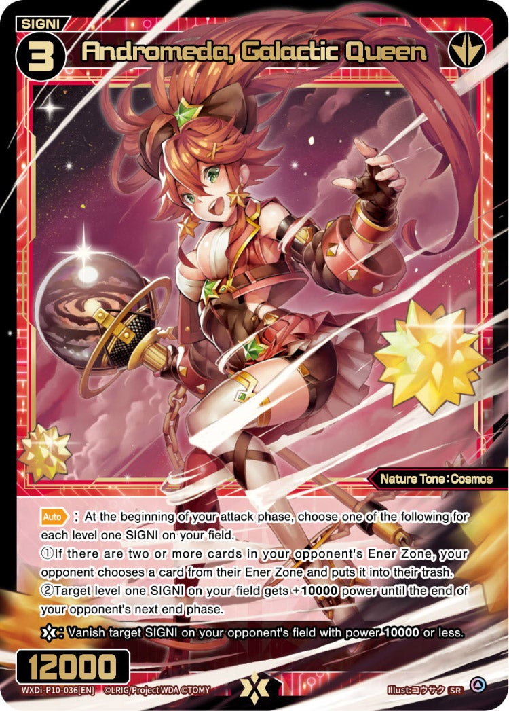

# Andromeda, Galactic Queen

## Thông tin lá

| Trường | Giá trị |
| --- | --- |
| Mã in | WXDi-P10-036[EN] |
| Set | WXDi-P10[EN] |
| Số thứ tự | 036 |
| Loại thẻ | SIGNI |
| Vị trí | Main Deck |
| Số bản | — (set booster, không áp dụng) |
| Màu | Đỏ |
| Độ hiếm | SR,SRP |
| Minh họa | コウサク |
| Level | 3 |
| Limit | — |
| Power | 12000 |
| LRIG type / Class | Nature Tone：Cosmos |
| Team / Master | — |
| Cost | — |
| Grow cost | — |
| Use timing | — |
| Life Burst | Có |

## Card text chính thức

[Auto]: At the beginning of your attack phase, choose one of the following for each level one SIGNI on your field.
①If there are two or more cards in your opponent's Ener Zone, your opponent chooses a card from their Ener Zone and puts it into their trash.
②Target level one SIGNI on your field gets +10000 power until the end of your opponent's next end phase.

## Power text / Life Burst

Vanish target SIGNI on your opponent's field with power 10000 or less.

## Ghi chú minh họa
Artist: コウサク. Ảnh SR được tải từ Card List tiếng Anh.

## FAQ chính thức

**Q. There are two level one SIGNI and one 《Andromeda, Galactic Queen》 in my field. May I use twice (2) of this [Auto] ability and my both level one SIGNI get +10000 power?**
A. No, you cannot. If you have two level one SIGNI, you can choose two from the options of this [Auto] ability, but you cannot choose the same option, so in that case you will do (1) and (2) once each.

## Ảnh biến thể

- [SRP](../images/WXDi-P10-036P-EN.jpg)

## Nguồn
[Card List/FAQ chính thức](https://www.takaratomy.co.jp/products/en.wixoss/card/card.html?card_no=WXDi-P10-036%5BEN%5D ) · [Ảnh thẻ](https://www.takaratomy.co.jp/products/en.wixoss/card/thumb/WXDi-P10-036%5BEN%5D.jpg)
