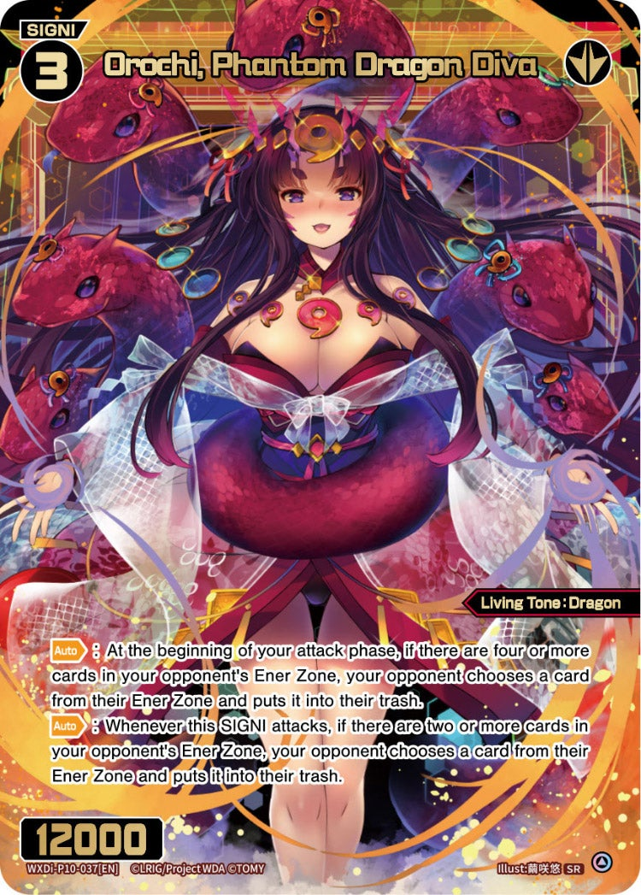

# Orochi, Phantom Dragon Diva

## Thông tin lá

| Trường | Giá trị |
| --- | --- |
| Mã in | WXDi-P10-037[EN] |
| Set | WXDi-P10[EN] |
| Số thứ tự | 037 |
| Loại thẻ | SIGNI |
| Vị trí | Main Deck |
| Số bản | — (set booster, không áp dụng) |
| Màu | Đỏ |
| Độ hiếm | SR,SRP |
| Minh họa | 繭咲悠 |
| Level | 3 |
| Limit | — |
| Power | 12000 |
| LRIG type / Class | Living Tone：Dragon |
| Team / Master | — |
| Cost | — |
| Grow cost | — |
| Use timing | — |
| Life Burst | Không |

## Card text chính thức

[Auto]: At the beginning of your attack phase, if there are four or more cards in your opponent's Ener Zone, your opponent chooses a card from their Ener Zone and puts it into their trash.
[Auto]: Whenever this SIGNI attacks, if there are two or more cards in your opponent's Ener Zone, your opponent chooses a card from their Ener Zone and puts it into their trash.

## Power text / Life Burst

—

## Ghi chú minh họa
Artist: 繭咲悠. Ảnh SR được tải từ Card List tiếng Anh.

## FAQ chính thức

**Q. There are two 《Orochi, Phantom Dragon Diva》 in my field, and there are four cards in my opponent's Ener Zone. What happens both abilities at the beginning of my attack phase?**
A. At the beginning of your attack phases, each 《Orochi, Phantom Dragon Diva》 ability is triggered and prosseced in order. If the first one is resolved, your opponent's cards in their Ener zone will be reduced by one, and nothing will happen in processing of the second one.

## Ảnh biến thể

- [SRP](../images/WXDi-P10-037P-EN.jpg)

## Nguồn
[Card List/FAQ chính thức](https://www.takaratomy.co.jp/products/en.wixoss/card/card.html?card_no=WXDi-P10-037%5BEN%5D ) · [Ảnh thẻ](https://www.takaratomy.co.jp/products/en.wixoss/card/thumb/WXDi-P10-037%5BEN%5D.jpg)
