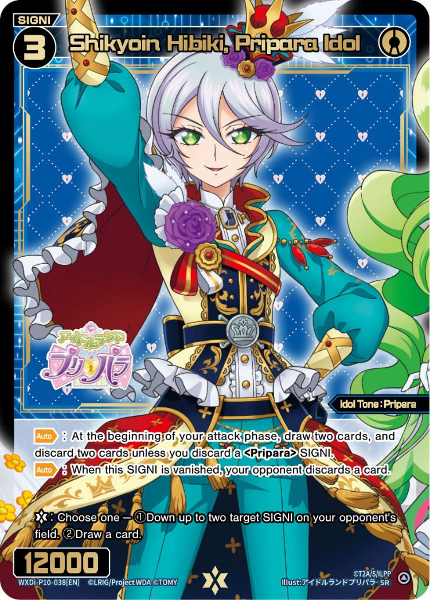

# Shikyoin Hibiki, Pripara Idol

## Thông tin lá

| Trường | Giá trị |
| --- | --- |
| Mã in | WXDi-P10-038[EN] |
| Set | WXDi-P10[EN] |
| Số thứ tự | 038 |
| Loại thẻ | SIGNI |
| Vị trí | Main Deck |
| Số bản | — (set booster, không áp dụng) |
| Màu | Xanh dương |
| Độ hiếm | SR,SRP |
| Minh họa | アイドルランドプリパラ |
| Level | 3 |
| Limit | — |
| Power | 12000 |
| LRIG type / Class | Idol Tone：Pripara |
| Team / Master | — |
| Cost | — |
| Grow cost | — |
| Use timing | — |
| Life Burst | Có |

## Card text chính thức

[Auto]: At the beginning of your attack phase, draw two cards, and discard two cards unless you discard a <Pripara> SIGNI.
[Auto]: When this SIGNI is vanished, your opponent discards a card.

## Power text / Life Burst

Choose one — ①Down up to two target SIGNI on your opponent's field. ②Draw a card.

## Ghi chú minh họa
Artist: アイドルランドプリパラ. Ảnh SR được tải từ Card List tiếng Anh.

## FAQ chính thức

**Q. May I discard two <Pripara> SIGNI by the first [Auto] ability?**
A. Yes, you can.

## Ảnh biến thể

- [SRP](../images/WXDi-P10-038P-EN.jpg)

## Nguồn
[Card List/FAQ chính thức](https://www.takaratomy.co.jp/products/en.wixoss/card/card.html?card_no=WXDi-P10-038%5BEN%5D ) · [Ảnh thẻ](https://www.takaratomy.co.jp/products/en.wixoss/card/thumb/WXDi-P10-038%5BEN%5D.jpg)
