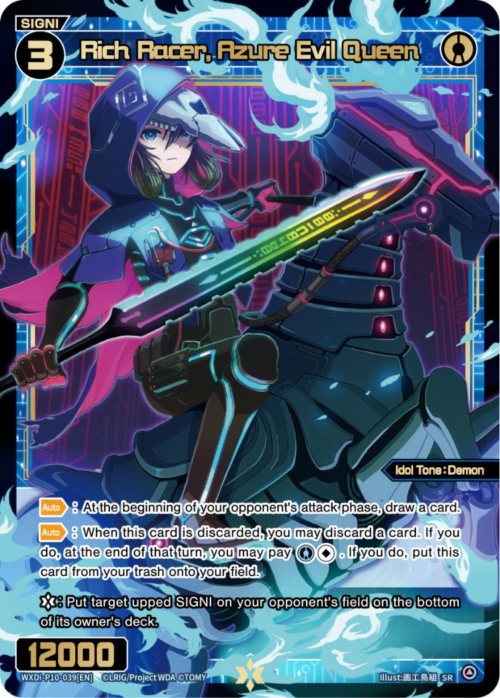

# Rich Racer, Azure Evil Queen

## Thông tin lá

| Trường | Giá trị |
| --- | --- |
| Mã in | WXDi-P10-039[EN] |
| Set | WXDi-P10[EN] |
| Số thứ tự | 039 |
| Loại thẻ | SIGNI |
| Vị trí | Main Deck |
| Số bản | — (set booster, không áp dụng) |
| Màu | Xanh dương |
| Độ hiếm | SR,SRP |
| Minh họa | 画工鳥組 |
| Level | 3 |
| Limit | — |
| Power | 12000 |
| LRIG type / Class | Idol Tone：Demon |
| Team / Master | — |
| Cost | — |
| Grow cost | — |
| Use timing | — |
| Life Burst | Có |

## Card text chính thức

[Auto]: At the beginning of your opponent's attack phase, draw a card.

[Auto]: When this card is discarded, you may discard a card. If you do, at the end of that turn, you may pay {Blue} {Colorless}. If you do, put this card from your trash onto your field.

## Power text / Life Burst

Put target upped SIGNI on your opponent's field on the bottom of its owner's deck.

## Ghi chú minh họa
Artist: 画工鳥組. Ảnh SR được tải từ Card List tiếng Anh.

## FAQ chính thức

**Q. How do I process the second [Auto] ability?**
A. When this card was discarded from your hand, the second [Auto] ability triggers. You can discard a card from your hand when triggered. If you do, you can pay {Blue} {Colorless} at the end of the that turn, and this card can be put on your field from your trash.

**Q. By my opponent's 《Bradamante, Azure General》 ability, the frozen SIGNI was vanished and I discard a card at the end of turn. If  that card is 《Rich Racer, Azure Evil Queen》, may I put it on my field with the second [Auto] ability?**
A. No, you cannot. "At the end of that turn" of 《Rich Racer, Azure Evil Queen》 is when the end phase of that turn is over, and in this case the timing of triggering this ability has passed.

## Ảnh biến thể

- [SRP](../images/WXDi-P10-039P-EN.jpg)

## Nguồn
[Card List/FAQ chính thức](https://www.takaratomy.co.jp/products/en.wixoss/card/card.html?card_no=WXDi-P10-039%5BEN%5D ) · [Ảnh thẻ](https://www.takaratomy.co.jp/products/en.wixoss/card/thumb/WXDi-P10-039%5BEN%5D.jpg)
