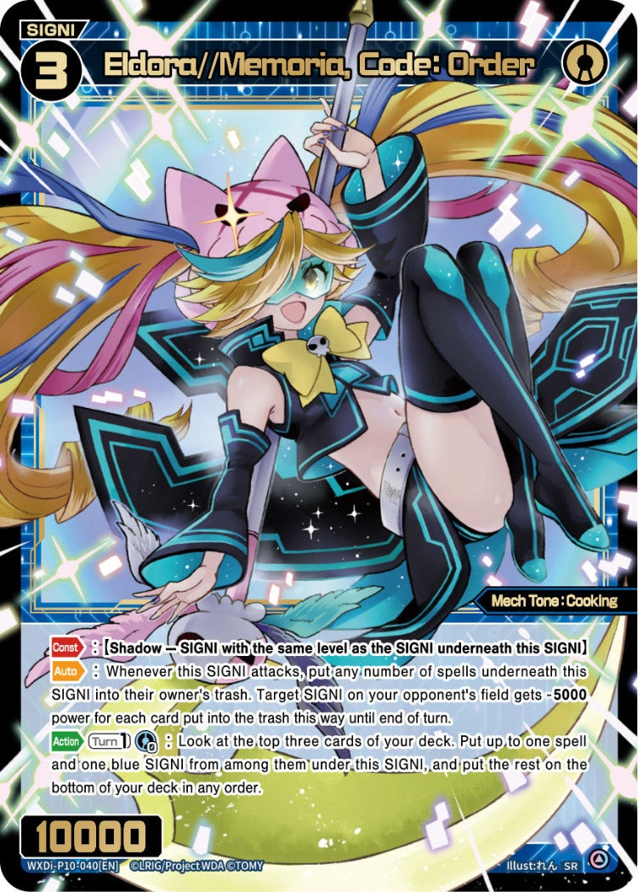

# Eldora//Memoria, Code: Order

## Thông tin lá

| Trường | Giá trị |
| --- | --- |
| Mã in | WXDi-P10-040[EN] |
| Set | WXDi-P10[EN] |
| Số thứ tự | 040 |
| Loại thẻ | SIGNI |
| Vị trí | Main Deck |
| Số bản | — (set booster, không áp dụng) |
| Màu | Xanh dương |
| Độ hiếm | SR,SRP |
| Minh họa | れん |
| Level | 3 |
| Limit | — |
| Power | 10000 |
| LRIG type / Class | Mech Tone：Cooking |
| Team / Master | — |
| Cost | — |
| Grow cost | — |
| Use timing | — |
| Life Burst | Không |

## Card text chính thức

[Constant]: 【Shadow — SIGNI with the same level as the SIGNI underneath this SIGNI】
[Auto]: Whenever this SIGNI attacks, put any number of spells underneath this SIGNI into their owner's trash. Target SIGNI on your opponent's field gets -5000 power for each card put into the trash this way until end of turn.
[Action] {1/Turn} {Bluex0}: Look at the top three cards of your deck. Put up to one spell and one blue SIGNI from among them under this SIGNI, and put the rest on the bottom of your deck in any order.

## Power text / Life Burst

—

## Ghi chú minh họa
Artist: れん. Ảnh SR được tải từ Card List tiếng Anh.

## FAQ chính thức

**Q. Does "underneath this SIGNI" include the SIGNI attached to this SINGI as [Acce] or [Soul]?**
A. No, it doesn't include them. The card underneath the SIGNI is include the one that puts a card under the SIGNI with an effect, such as this card's [Action] ability, or the SIGNI is placed on the SIGNI with [Rise], etc. Cards such as [Acce], [Soul] or cards that are hidden face down in the SIGNI zone are not "underneath this SIGNI" even if they are physically placced under the SIGNI.

**Q. If there are level one SIGNI and level two SIGNI underneath this SIGNI, does this card get [Shadow] for both levels?**
A. Yes, in that case it becomes [Shadow - level one and level two SIGNI], and it is not targeted by abilities or Life Burst of your opponent's level one and level two SIGNI.

**Q. When I look three cards on the top of my deck by the [Action] ability, there was no spell in them. May I put only one blue SIGNI underneath this SIGNI?**
A. Yes, you can.

**Q. If I put a card underneath this SIGNI with the [Action] ability, is it face up?**
A. It is face up. If you put a card underneath the SIGNI, it will be placed face up unless there is any description.

## Ảnh biến thể

- [SRP](../images/WXDi-P10-040P-EN.jpg)

## Nguồn
[Card List/FAQ chính thức](https://www.takaratomy.co.jp/products/en.wixoss/card/card.html?card_no=WXDi-P10-040%5BEN%5D ) · [Ảnh thẻ](https://www.takaratomy.co.jp/products/en.wixoss/card/thumb/WXDi-P10-040%5BEN%5D.jpg)
