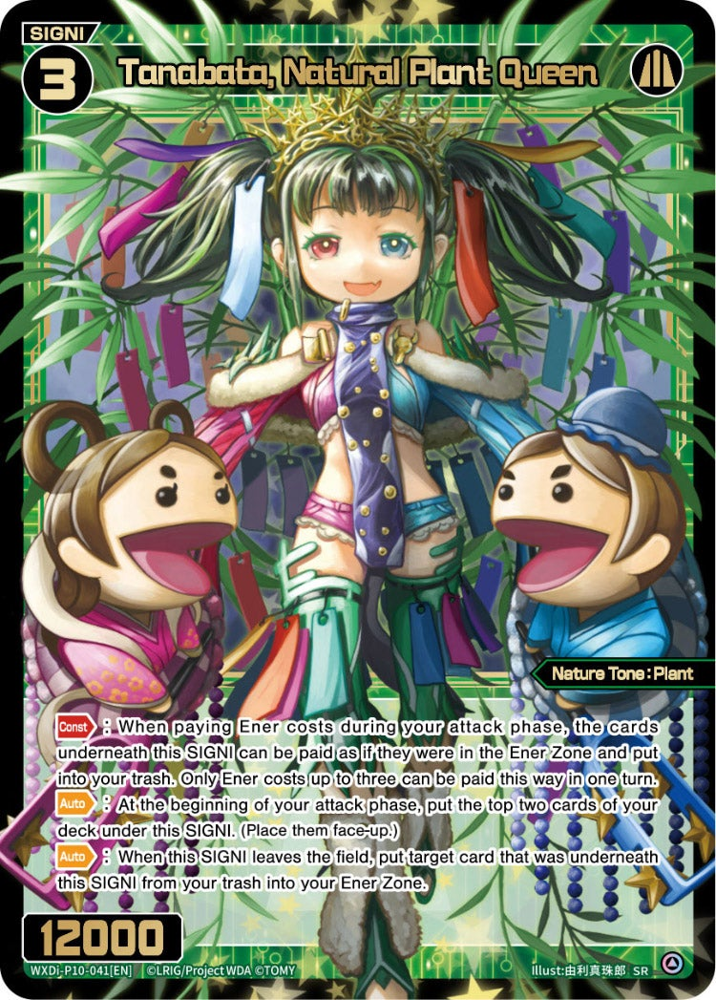

# Tanabata, Natural Plant Queen

## Thông tin lá

| Trường | Giá trị |
| --- | --- |
| Mã in | WXDi-P10-041[EN] |
| Set | WXDi-P10[EN] |
| Số thứ tự | 041 |
| Loại thẻ | SIGNI |
| Vị trí | Main Deck |
| Số bản | — (set booster, không áp dụng) |
| Màu | Xanh lá |
| Độ hiếm | SR,SRP |
| Minh họa | 由利真珠郎 |
| Level | 3 |
| Limit | — |
| Power | 12000 |
| LRIG type / Class | Nature Tone：Plant |
| Team / Master | — |
| Cost | — |
| Grow cost | — |
| Use timing | — |
| Life Burst | Không |

## Card text chính thức

[Constant]: When paying Ener costs during your attack phase, the cards underneath this SIGNI can be paid as if they were in the Ener Zone and put into your trash. Only Ener costs up to three can be paid this way in one turn.
[Auto]: At the beginning of your attack phase, put the top two cards of your deck under this SIGNI. (Place them face-up.)
[Auto]: When this SIGNI leaves the field, put target card that was underneath this SIGNI from your trash into your Ener Zone.

## Power text / Life Burst

—

## Ghi chú minh họa
Artist: 由利真珠郎. Ảnh SR được tải từ Card List tiếng Anh.

## FAQ chính thức

**Q. If you pay Ener cost with this [Const] ability, will [Multi Ener] be applied?**
A. Yes, cards underneath this SIGNI is "as if they were in the Ener Zone and put into your trash.", so [Multi Ener] is applied. For example, 《Servant #》 underneath 《Tanabata, Natural Plant Queen》 can be paid as one of any colors.

**Q. There are two 《Tanabata, Natural Plant Queen》 in my field, and there are three cards underneath each one. May I pay the Ener costs with the [Const] abilities of each 《Tanabata, Natural Plant Queen》?**
A. Yes, you can pay up to three cards each one in a turn. For example, if you will use PIECE with {Colorless} x 6 cost, you can also pay each three cards from the underneath of two 《Tanabata, Natural Plant Queen》.

**Q. What happens if the first [Auto] ability was triggered at the beginning of my attack phase when my deck has only one card?**
A. In that case, put the remaining one card underneath this SIGNI and finish the process. After that, refresh your deck because the deck is 0.

**Q. How do I process the second [Auto] ability when this SIGNI was leave?**
A. If this SIGNI was left on your field, the cards underneath it will be put into your trash bu Rule-based Action (after processing some effect if it leave your field due to some effect). After that, the second [Auto] ability of "When this SIGNI leaves the field" triggers and resolves. From your trash, choose one of the carlds put in your trash by the Rule-based Action and put it into your Ener Zone.

## Ảnh biến thể

- [SRP](../images/WXDi-P10-041P-EN.jpg)

## Nguồn
[Card List/FAQ chính thức](https://www.takaratomy.co.jp/products/en.wixoss/card/card.html?card_no=WXDi-P10-041%5BEN%5D ) · [Ảnh thẻ](https://www.takaratomy.co.jp/products/en.wixoss/card/thumb/WXDi-P10-041%5BEN%5D.jpg)
