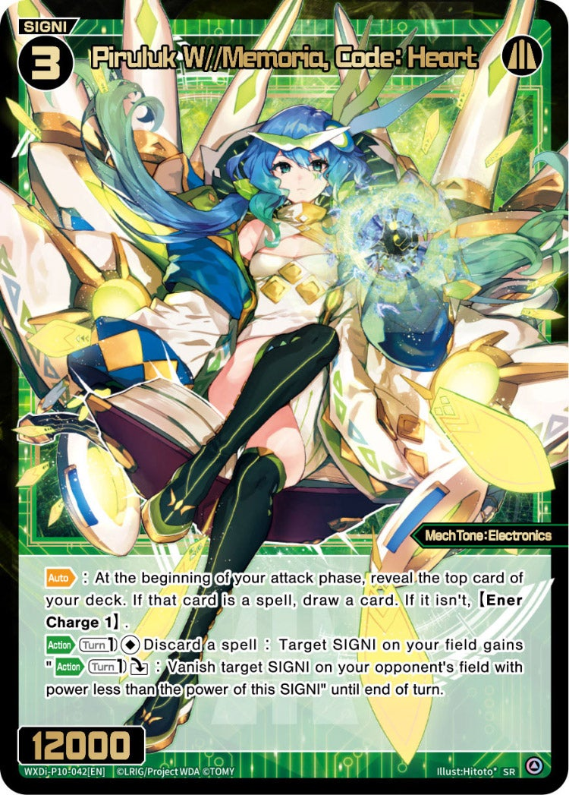

# Piruluk W//Memoria, Code: Heart

## Thông tin lá

| Trường | Giá trị |
| --- | --- |
| Mã in | WXDi-P10-042[EN] |
| Set | WXDi-P10[EN] |
| Số thứ tự | 042 |
| Loại thẻ | SIGNI |
| Vị trí | Main Deck |
| Số bản | — (set booster, không áp dụng) |
| Màu | Xanh lá |
| Độ hiếm | SR,SRP |
| Minh họa | Hitoto* |
| Level | 3 |
| Limit | — |
| Power | 12000 |
| LRIG type / Class | Mech Tone：Electronics |
| Team / Master | — |
| Cost | — |
| Grow cost | — |
| Use timing | — |
| Life Burst | Không |

## Card text chính thức

[Auto]: At the beginning of your attack phase, reveal the top card of your deck. If that card is a spell, draw a card. If it isn't, 【Ener Charge 1】.
[Action] {1/Turn} {Colorless} Discard a spell: Target SIGNI on your field gains "[Action] {1/Turn} {Down}: Vanish target SIGNI on your opponent's field with power less than the power of this SIGNI" until end of turn.

## Power text / Life Burst

—

## Ghi chú minh họa
Artist: Hitoto*. Ảnh SR được tải từ Card List tiếng Anh.

## FAQ chính thức

**Q. What happens if it is 《Moon Bites》 when I revealed the top of my deck by the [Auto] ability?**
A. Decide whether to treat it as SIGNI by the ability of 《Moon Bites》, and follow it. If you teat it as level one SIGNI, you will do [Ener Charge 1], and if you do not, draw a card (in either case, 《Moon Bites》 will move).

## Ảnh biến thể

- [SRP](../images/WXDi-P10-042P-EN.jpg)

## Nguồn
[Card List/FAQ chính thức](https://www.takaratomy.co.jp/products/en.wixoss/card/card.html?card_no=WXDi-P10-042%5BEN%5D ) · [Ảnh thẻ](https://www.takaratomy.co.jp/products/en.wixoss/card/thumb/WXDi-P10-042%5BEN%5D.jpg)
