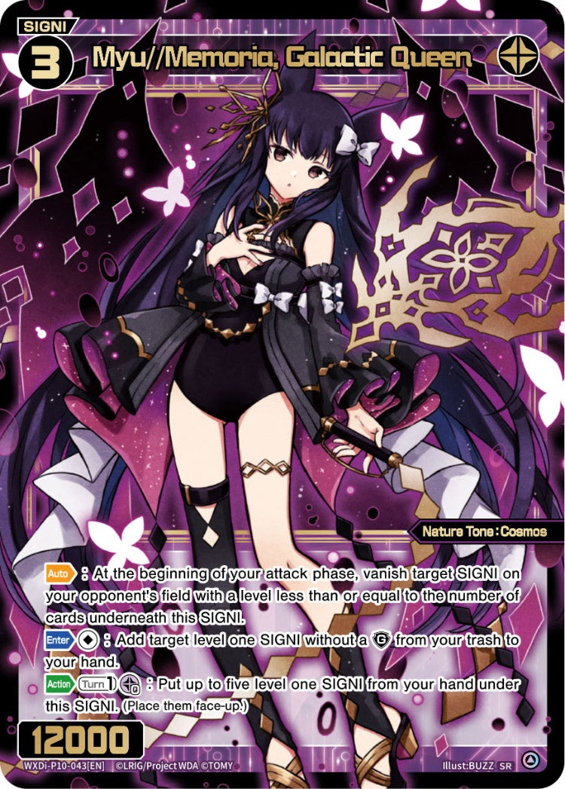

# Myu//Memoria, Galactic Queen

## Thông tin lá

| Trường | Giá trị |
| --- | --- |
| Mã in | WXDi-P10-043[EN] |
| Set | WXDi-P10[EN] |
| Số thứ tự | 043 |
| Loại thẻ | SIGNI |
| Vị trí | Main Deck |
| Số bản | — (set booster, không áp dụng) |
| Màu | Đen |
| Độ hiếm | SR,SRP |
| Minh họa | BUZZ |
| Level | 3 |
| Limit | — |
| Power | 12000 |
| LRIG type / Class | Nature Tone：Cosmos |
| Team / Master | — |
| Cost | — |
| Grow cost | — |
| Use timing | — |
| Life Burst | Không |

## Card text chính thức

[Auto]: At the beginning of your attack phase, vanish target SIGNI on your opponent's field with a level less than or equal to the number of cards underneath this SIGNI.
[Enter] {Colorless}: Add target level one SIGNI without a {Guard Icon} from your trash to your hand.
[Action] {1/Turn} {Blackx0}: Put up to five level one SIGNI from your hand under this SIGNI. (Place them face-up.)

## Power text / Life Burst

—

## Ghi chú minh họa
Artist: BUZZ. Ảnh SR được tải từ Card List tiếng Anh.

## FAQ chính thức

**Q. Does "underneath this SIGNI" include the SIGNI attached to this SINGI as [Acce] or [Soul]?**
A. No, it doesn't include them. The card underneath the SIGNI includes the one that puts a card under the SIGNI with an effect, such as this card's [Action] ability, or the SIGNI is placed on the SIGNI with [Rise], etc. Cards such as [Acce], [Soul] or cards that are hidden face down in the SIGNI zone are not "underneath this SIGNI" even if they are physically placced under the SIGNI.

**Q. May I add the card paid at the Ener cost of the [Enter] ability to my hand by that effect?**
A. Yes, if it is a card that meets the conditions.

## Ảnh biến thể

- [SRP](../images/WXDi-P10-043P-EN.jpg)

## Nguồn
[Card List/FAQ chính thức](https://www.takaratomy.co.jp/products/en.wixoss/card/card.html?card_no=WXDi-P10-043%5BEN%5D ) · [Ảnh thẻ](https://www.takaratomy.co.jp/products/en.wixoss/card/thumb/WXDi-P10-043%5BEN%5D.jpg)
