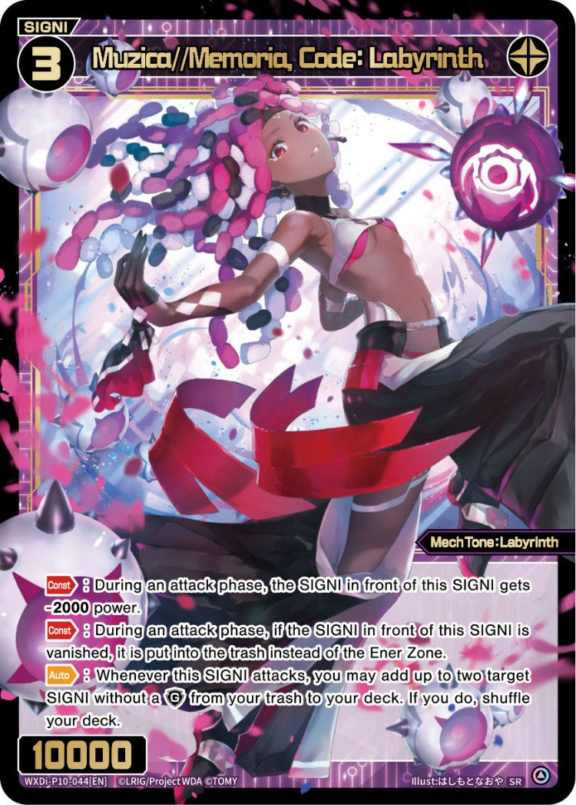

# Muzica//Memoria, Code: Labyrinth

## Thông tin lá

| Trường | Giá trị |
| --- | --- |
| Mã in | WXDi-P10-044[EN] |
| Set | WXDi-P10[EN] |
| Số thứ tự | 044 |
| Loại thẻ | SIGNI |
| Vị trí | Main Deck |
| Số bản | — (set booster, không áp dụng) |
| Màu | Đen |
| Độ hiếm | SR,SRP |
| Minh họa | はしもとなおや |
| Level | 3 |
| Limit | — |
| Power | 10000 |
| LRIG type / Class | Mech Tone：Labyrinth |
| Team / Master | — |
| Cost | — |
| Grow cost | — |
| Use timing | — |
| Life Burst | Không |

## Card text chính thức

[Constant]: During an attack phase, the SIGNI in front of this SIGNI gets -2000 power.
[Constant]: During an attack phase, if the SIGNI in front of this SIGNI is vanished, it is put into the trash instead of the Ener Zone.
[Auto]: Whenever this SIGNI attacks, you may add up to two target SIGNI without a {Guard Icon} from your trash to your deck. If you do, shuffle your deck.

## Power text / Life Burst

—

## Ghi chú minh họa
Artist: はしもとなおや. Ảnh SR được tải từ Card List tiếng Anh.

## FAQ chính thức

**Q. If the SIGNI with power 2000 or less in the front of this SIGNI has an [Auto] ability of "at the beginning of the attack phase", will it trigger?**
A. Yes, it will trigger. At the beginning of the attack phase, the power of that SIGNI is less than 0 due to the [Const] ability of this SIGNI, and after the ability is triggered, the SIGNI is vanished. After that, the triggered ability is resolved.

## Ảnh biến thể

- [SRP](../images/WXDi-P10-044P-EN.jpg)

## Nguồn
[Card List/FAQ chính thức](https://www.takaratomy.co.jp/products/en.wixoss/card/card.html?card_no=WXDi-P10-044%5BEN%5D ) · [Ảnh thẻ](https://www.takaratomy.co.jp/products/en.wixoss/card/thumb/WXDi-P10-044%5BEN%5D.jpg)
