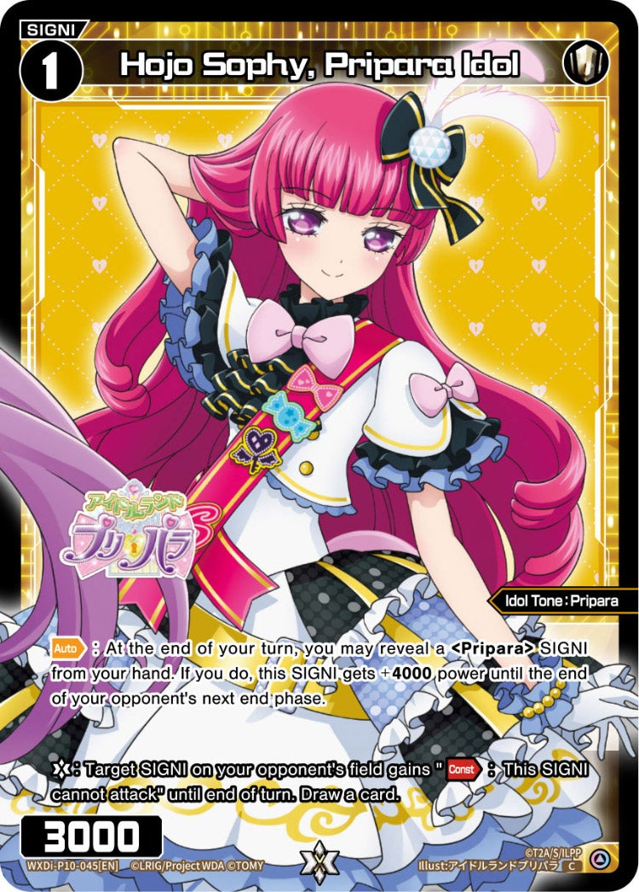

# Hojo Sophy, Pripara Idol

## Thông tin lá

| Trường | Giá trị |
| --- | --- |
| Mã in | WXDi-P10-045[EN] |
| Set | WXDi-P10[EN] |
| Số thứ tự | 045 |
| Loại thẻ | SIGNI |
| Vị trí | Main Deck |
| Số bản | — (set booster, không áp dụng) |
| Màu | Trắng |
| Độ hiếm | C,C(P) |
| Minh họa | アイドルランドプリパラ |
| Level | 1 |
| Limit | — |
| Power | 3000 |
| LRIG type / Class | Idol Tone：Pripara |
| Team / Master | — |
| Cost | — |
| Grow cost | — |
| Use timing | — |
| Life Burst | Có |

## Card text chính thức

[Auto]: At the end of your turn, you may reveal a <Pripara> SIGNI from your hand. If you do, this SIGNI gets +4000 power until the end of your opponent's next end phase.

## Power text / Life Burst

Target SIGNI on your opponent's field gains "[Constant]: This SIGNI cannot attack" until end of turn. Draw a card.

## Ghi chú minh họa
Artist: アイドルランドプリパラ. Ảnh C được tải từ Card List tiếng Anh.

## FAQ chính thức

**Q. In Life Burst ability, May I draw a card even if there is no my opponent's SIGNI?**
A. Yes, you can. Even if there is no your opponent's SIGNI or your opponent's SIGNI have [Shadow] and you cannot choose, the effects of the second half will be processed.

## Ảnh biến thể

- [C(P)](../images/WXDi-P10-045P-EN.jpg)

## Nguồn
[Card List/FAQ chính thức](https://www.takaratomy.co.jp/products/en.wixoss/card/card.html?card_no=WXDi-P10-045%5BEN%5D ) · [Ảnh thẻ](https://www.takaratomy.co.jp/products/en.wixoss/card/thumb/WXDi-P10-045%5BEN%5D.jpg)
