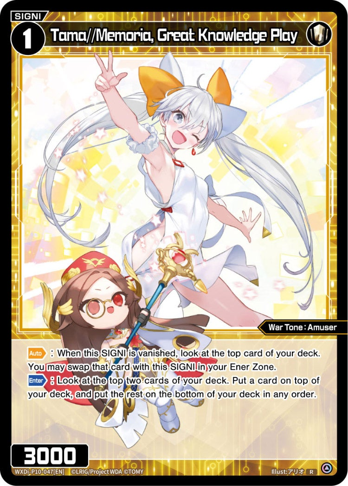

# Tama//Memoria, Great Knowledge Play

## Thông tin lá

| Trường | Giá trị |
| --- | --- |
| Mã in | WXDi-P10-047[EN] |
| Set | WXDi-P10[EN] |
| Số thứ tự | 047 |
| Loại thẻ | SIGNI |
| Vị trí | Main Deck |
| Số bản | — (set booster, không áp dụng) |
| Màu | Trắng |
| Độ hiếm | R,R(P) |
| Minh họa | アリオ |
| Level | 1 |
| Limit | — |
| Power | 3000 |
| LRIG type / Class | War Tone：Amuser |
| Team / Master | — |
| Cost | — |
| Grow cost | — |
| Use timing | — |
| Life Burst | Không |

## Card text chính thức

[Auto]: When this SIGNI is vanished, look at the top card of your deck. You may swap that card with this SIGNI in your Ener Zone.
[Enter]: Look at the top two cards of your deck. Put a card on top of your deck, and put the rest on the bottom of your deck in any order.

## Power text / Life Burst

—

## Ghi chú minh họa
Artist: アリオ. Ảnh R được tải từ Card List tiếng Anh.

## FAQ chính thức

**Q. If I replace this SIGNI on top card of my deck and this SIGNI in my Ener Zone with [Auto] ability, will they be face up?**
A. This SIGNI on the top of your deck should be face down, and the card put into your Ener Zone is face up.

**Q. Does the [Enter] ability have to be triggered?**
A. Yes, the [Enter] ability without cost is must triggered. Look at the top two cards of your deck, you need to return one on the top of your deck. If there is only one card in your deck, look at it and then return to your deck.

## Ảnh biến thể

- [R(P)](../images/WXDi-P10-047P-EN.jpg)

## Nguồn
[Card List/FAQ chính thức](https://www.takaratomy.co.jp/products/en.wixoss/card/card.html?card_no=WXDi-P10-047%5BEN%5D ) · [Ảnh thẻ](https://www.takaratomy.co.jp/products/en.wixoss/card/thumb/WXDi-P10-047%5BEN%5D.jpg)
