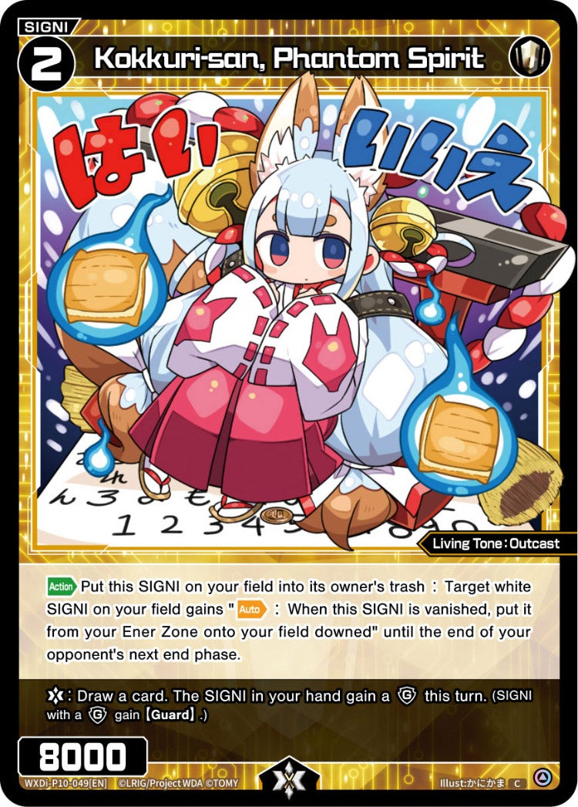

# Kokkuri-san, Phantom Spirit

## Thông tin lá

| Trường | Giá trị |
| --- | --- |
| Mã in | WXDi-P10-049[EN] |
| Set | WXDi-P10[EN] |
| Số thứ tự | 049 |
| Loại thẻ | SIGNI |
| Vị trí | Main Deck |
| Số bản | — (set booster, không áp dụng) |
| Màu | Trắng |
| Độ hiếm | C,C(P) |
| Minh họa | かにかま |
| Level | 2 |
| Limit | — |
| Power | 8000 |
| LRIG type / Class | Living Tone：Outcast |
| Team / Master | — |
| Cost | — |
| Grow cost | — |
| Use timing | — |
| Life Burst | Có |

## Card text chính thức

[Action] Put this SIGNI on your field into its owner's trash: Target white SIGNI on your field gains "[Auto]: When this SIGNI is vanished, put it from your Ener Zone onto your field downed" until the end of your opponent's next end phase.

## Power text / Life Burst

Draw a card. The SIGNI in your hand gain a {Guard Icon} this turn. (SIGNI with a {Guard Icon} gain 【Guard】.)

## Ghi chú minh họa
Artist: かにかま. Ảnh C được tải từ Card List tiếng Anh.

## FAQ chính thức

**Q. The targeted white SIGNI by the [Action] ability has been vanished. Which SIGNI zone do I put on SIGNI zone as I put downed SIGNI from my Ener zone?**
A. If it's an empty SIGNI zone, you can put it in any of SIGNI zone. It doesn't have to be the original SIGNI zone.

**Q. My SIGNI given the [Auto] ability by 《Kokkuri-san, Phantom Sprit》 was vanished and I put it from my Ener zone on my field downed. Does the SIGNI have the [Auto] ability of 《Kokkuri-san, Phantom Sprit》 after leaveing my field?**
A. No, it has not given it. SIGNI that has moved to another zone is treated as a different SIGNI of the original SIGNI, and does not take over the effects given.

## Ảnh biến thể

- [C(P)](../images/WXDi-P10-049P-EN.jpg)

## Nguồn
[Card List/FAQ chính thức](https://www.takaratomy.co.jp/products/en.wixoss/card/card.html?card_no=WXDi-P10-049%5BEN%5D ) · [Ảnh thẻ](https://www.takaratomy.co.jp/products/en.wixoss/card/thumb/WXDi-P10-049%5BEN%5D.jpg)
