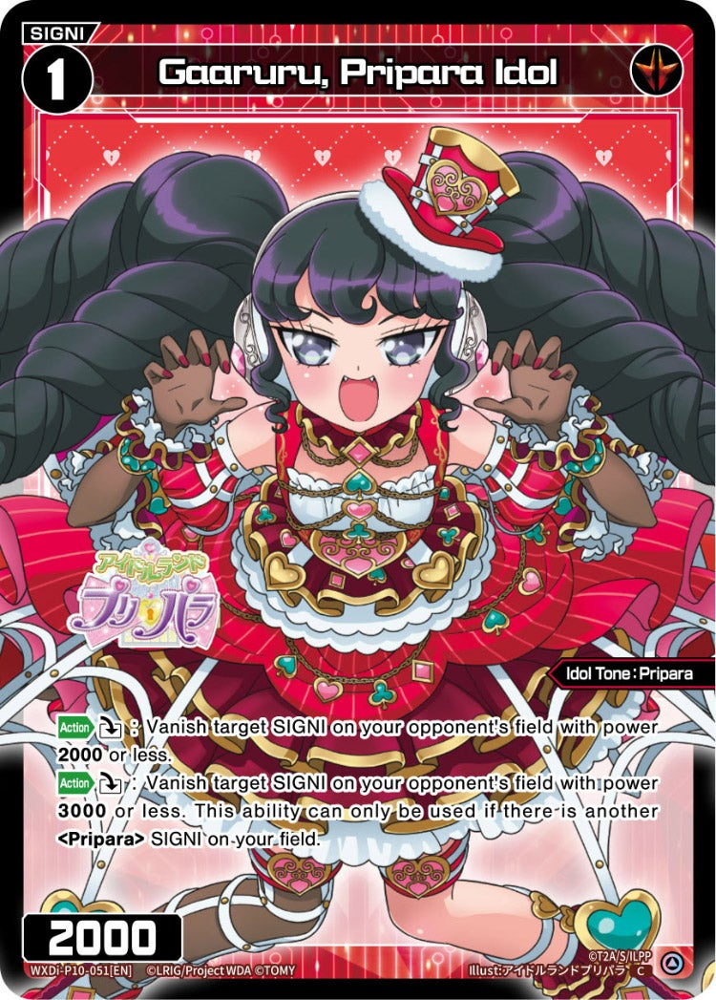

# Gaaruru, Pripara Idol

## Thông tin lá

| Trường | Giá trị |
| --- | --- |
| Mã in | WXDi-P10-051[EN] |
| Set | WXDi-P10[EN] |
| Số thứ tự | 051 |
| Loại thẻ | SIGNI |
| Vị trí | Main Deck |
| Số bản | — (set booster, không áp dụng) |
| Màu | Đỏ |
| Độ hiếm | C,C(P) |
| Minh họa | アイドルランドプリパラ |
| Level | 1 |
| Limit | — |
| Power | 2000 |
| LRIG type / Class | Idol Tone：Pripara |
| Team / Master | — |
| Cost | — |
| Grow cost | — |
| Use timing | — |
| Life Burst | Không |

## Card text chính thức

[Action] {Down}: Vanish target SIGNI on your opponent's field with power 2000 or less.
[Action] {Down}: Vanish target SIGNI on your opponent's field with power 3000 or less. This ability can only be used if there is another <Pripara> SIGNI on your field.

## Power text / Life Burst

—

## Ghi chú minh họa
Artist: アイドルランドプリパラ. Ảnh C được tải từ Card List tiếng Anh.

## FAQ chính thức

**Q. If there are two 《Gaaruru, Pripara Idol》 on my field, may I use the second [Action] ability?**
A. Yes, you can.

## Ảnh biến thể

- [C(P)](../images/WXDi-P10-051P-EN.jpg)

## Nguồn
[Card List/FAQ chính thức](https://www.takaratomy.co.jp/products/en.wixoss/card/card.html?card_no=WXDi-P10-051%5BEN%5D ) · [Ảnh thẻ](https://www.takaratomy.co.jp/products/en.wixoss/card/thumb/WXDi-P10-051%5BEN%5D.jpg)
