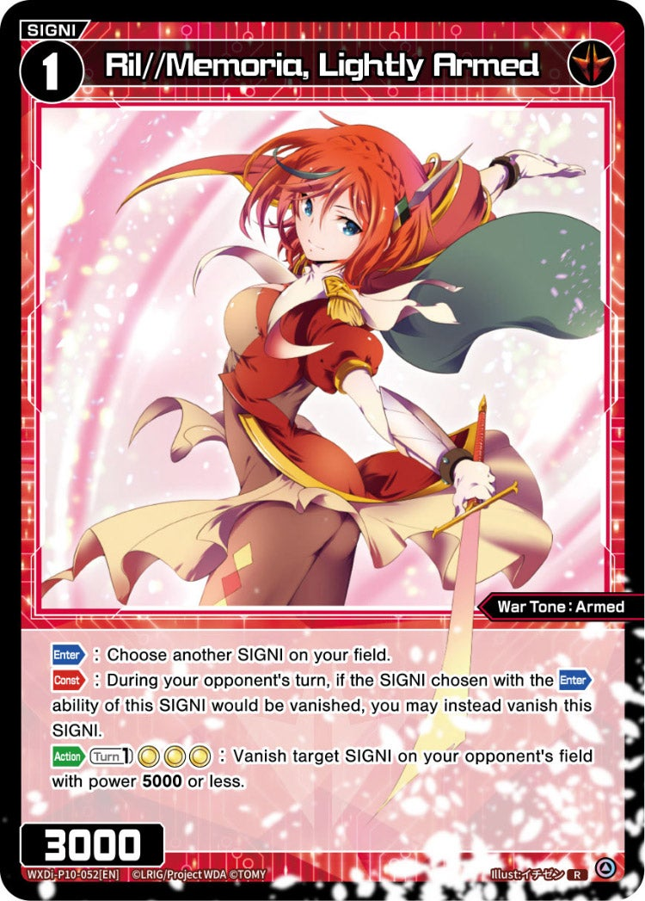

# Ril//Memoria, Lightly Armed

## Thông tin lá

| Trường | Giá trị |
| --- | --- |
| Mã in | WXDi-P10-052[EN] |
| Set | WXDi-P10[EN] |
| Số thứ tự | 052 |
| Loại thẻ | SIGNI |
| Vị trí | Main Deck |
| Số bản | — (set booster, không áp dụng) |
| Màu | Đỏ |
| Độ hiếm | R,R(P) |
| Minh họa | イチゼン |
| Level | 1 |
| Limit | — |
| Power | 3000 |
| LRIG type / Class | War Tone：Armed |
| Team / Master | — |
| Cost | — |
| Grow cost | — |
| Use timing | — |
| Life Burst | Không |

## Card text chính thức

[Enter]: Choose another SIGNI on your field.
[Constant]: During your opponent's turn, if the SIGNI chosen with the [Enter] ability of this SIGNI would be vanished, you may instead vanish this SIGNI.
[Action] {1/Turn} {Coin Icon} {Coin Icon} {Coin Icon}: Vanish target SIGNI on your opponent's field with power 5000 or less.

## Power text / Life Burst

—

## Ghi chú minh họa
Artist: イチゼン. Ảnh R được tải từ Card List tiếng Anh.

## FAQ chính thức

**Q. There are 《Ril//Memoria, Lightly Armed》 and one other SIGNI that targeted by this card's [Enter] ability. If my opponent use a card with "Vanish all SIGNI" effect, may I privent one other SIGNI by this card's [Const] ability?**
A. Yes, you can. In that case, 《Ril//Memoria, Lightly Armed》 is vanished, and one SIGNI choosen by the [Enter] ability remains on your field.

**Q. My opponent's SIGNI with [Lancer] battle to my targeted SIGNI with this card's [Enter] ability, and tried to vanish, so I vanish 《Ril//Memoria, Lightly Armed》 instead. Will [Lancer] trigger?**
A. Yes, it triggers. [Lancer] is triggered "Whenever a SIGNI on your field with 【Lancer】 vanishes a SIGNI on your opponent's field through battle,". In addition, the replacement effect of "B instead of A", such as the [Const] ability of 《Ril//Memoria, Lightly Armed》, does not change what the vanish is performed. Therefore, as a replacement result, SIGNI with [Lancer] has been vanish 《Ril//Memoria, Lightly Armed》 by the battle, and [Lancer] is triggered.

## Ảnh biến thể

- [R(P)](../images/WXDi-P10-052P-EN.jpg)

## Nguồn
[Card List/FAQ chính thức](https://www.takaratomy.co.jp/products/en.wixoss/card/card.html?card_no=WXDi-P10-052%5BEN%5D ) · [Ảnh thẻ](https://www.takaratomy.co.jp/products/en.wixoss/card/thumb/WXDi-P10-052%5BEN%5D.jpg)
