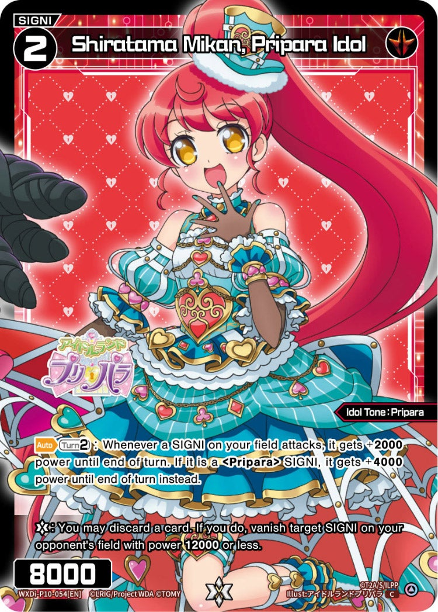

# Shiratama Mikan, Pripara Idol

## Thông tin lá

| Trường | Giá trị |
| --- | --- |
| Mã in | WXDi-P10-054[EN] |
| Set | WXDi-P10[EN] |
| Số thứ tự | 054 |
| Loại thẻ | SIGNI |
| Vị trí | Main Deck |
| Số bản | — (set booster, không áp dụng) |
| Màu | Đỏ |
| Độ hiếm | C,C(P) |
| Minh họa | アイドルランドプリパラ |
| Level | 2 |
| Limit | — |
| Power | 8000 |
| LRIG type / Class | Idol Tone：Pripara |
| Team / Master | — |
| Cost | — |
| Grow cost | — |
| Use timing | — |
| Life Burst | Có |

## Card text chính thức

[Auto] {2/Turn}: Whenever a SIGNI on your field attacks, it gets +2000 power until end of turn. If it is a <Pripara> SIGNI, it gets +4000 power until end of turn instead.

## Power text / Life Burst

You may discard a card. If you do, vanish target SIGNI on your opponent's field with power 12000 or less.

## Ghi chú minh họa
Artist: アイドルランドプリパラ. Ảnh C được tải từ Card List tiếng Anh.

## FAQ chính thức

**Q. May I choose not to trigger this SIGNI's [Auto] ability when my SIGNI attacks?**
A. No, [Auto] ability that meets the conditions must be triggered. You cannot choose not to trigger. For example, if you have three SIGNI, three SIGNI want to attack, this [Auto] ability is triggered by the first and second attack.

## Ảnh biến thể

- [C(P)](../images/WXDi-P10-054P-EN.jpg)

## Nguồn
[Card List/FAQ chính thức](https://www.takaratomy.co.jp/products/en.wixoss/card/card.html?card_no=WXDi-P10-054%5BEN%5D ) · [Ảnh thẻ](https://www.takaratomy.co.jp/products/en.wixoss/card/thumb/WXDi-P10-054%5BEN%5D.jpg)
