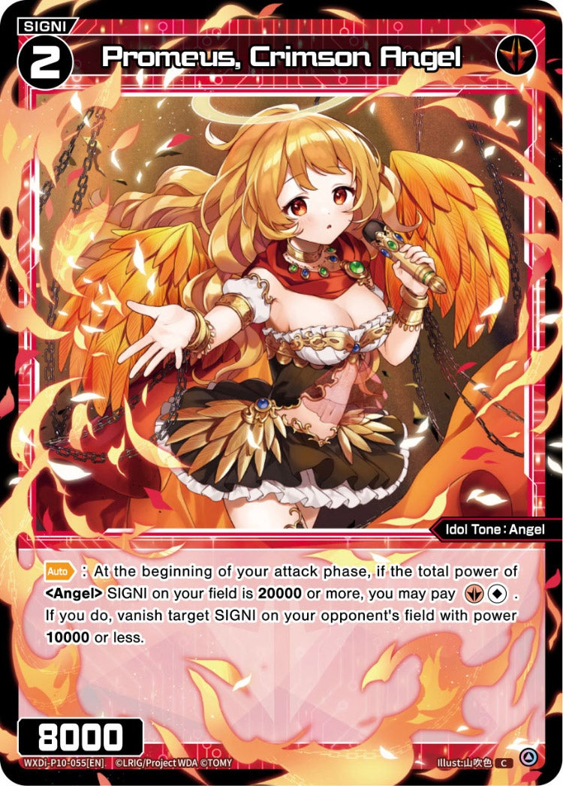

# Promeus, Crimson Angel

## Thông tin lá

| Trường | Giá trị |
| --- | --- |
| Mã in | WXDi-P10-055[EN] |
| Set | WXDi-P10[EN] |
| Số thứ tự | 055 |
| Loại thẻ | SIGNI |
| Vị trí | Main Deck |
| Số bản | — (set booster, không áp dụng) |
| Màu | Đỏ |
| Độ hiếm | C,C(P) |
| Minh họa | 山吹色 |
| Level | 2 |
| Limit | — |
| Power | 8000 |
| LRIG type / Class | Idol Tone：Angel |
| Team / Master | — |
| Cost | — |
| Grow cost | — |
| Use timing | — |
| Life Burst | Không |

## Card text chính thức

[Auto]: At the beginning of your attack phase, if the total power of <Angel> SIGNI on your field is 20000 or more, you may pay {Red} {Colorless}. If you do, vanish target SIGNI on your opponent's field with power 10000 or less.

## Power text / Life Burst

—

## Ghi chú minh họa
Artist: 山吹色. Ảnh C được tải từ Card List tiếng Anh.

## FAQ chính thức

**Q. As count the total power of the <Angel> SIGNI on my field, may I count the <Angel> SIGNI underneath the SIGNI?**
A. No, you don't count. When referring to the SIGNI of the <Angel> on your field, you count only SIGNI that are served as SIGNI (the limit of levels and limits), and do not including the cards attached and the cards that are underneath the SIGNI.

## Ảnh biến thể

- [C(P)](../images/WXDi-P10-055P-EN.jpg)

## Nguồn
[Card List/FAQ chính thức](https://www.takaratomy.co.jp/products/en.wixoss/card/card.html?card_no=WXDi-P10-055%5BEN%5D ) · [Ảnh thẻ](https://www.takaratomy.co.jp/products/en.wixoss/card/thumb/WXDi-P10-055%5BEN%5D.jpg)
