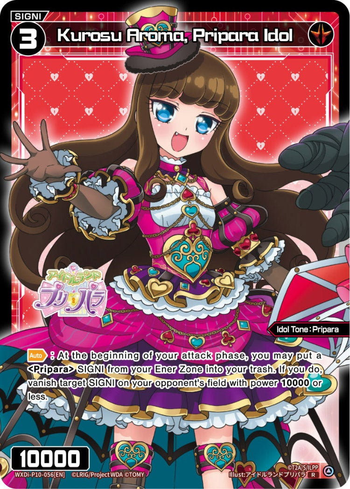

# Kurosu Aroma, Pripara Idol

## Thông tin lá

| Trường | Giá trị |
| --- | --- |
| Mã in | WXDi-P10-056[EN] |
| Set | WXDi-P10[EN] |
| Số thứ tự | 056 |
| Loại thẻ | SIGNI |
| Vị trí | Main Deck |
| Số bản | — (set booster, không áp dụng) |
| Màu | Đỏ |
| Độ hiếm | R,R(P) |
| Minh họa | アイドルランドプリパラ |
| Level | 3 |
| Limit | — |
| Power | 10000 |
| LRIG type / Class | Idol Tone：Pripara |
| Team / Master | — |
| Cost | — |
| Grow cost | — |
| Use timing | — |
| Life Burst | Không |

## Card text chính thức

[Auto]: At the beginning of your attack phase, you may put a <Pripara> SIGNI from your Ener Zone into your trash. If you do, vanish target SIGNI on your opponent's field with power 10000 or less.

## Power text / Life Burst

—

## Ghi chú minh họa
Artist: アイドルランドプリパラ. Ảnh R được tải từ Card List tiếng Anh.

## FAQ chính thức

**Q. At the beginning of my attack phase, do I choose the target SIGNI, even if I don't want to put <Pripara> SIGNI from my Ener zone into my trash?**
A. Yes, you need target it.

## Ảnh biến thể

- [R(P)](../images/WXDi-P10-056P-EN.jpg)

## Nguồn
[Card List/FAQ chính thức](https://www.takaratomy.co.jp/products/en.wixoss/card/card.html?card_no=WXDi-P10-056%5BEN%5D ) · [Ảnh thẻ](https://www.takaratomy.co.jp/products/en.wixoss/card/thumb/WXDi-P10-056%5BEN%5D.jpg)
