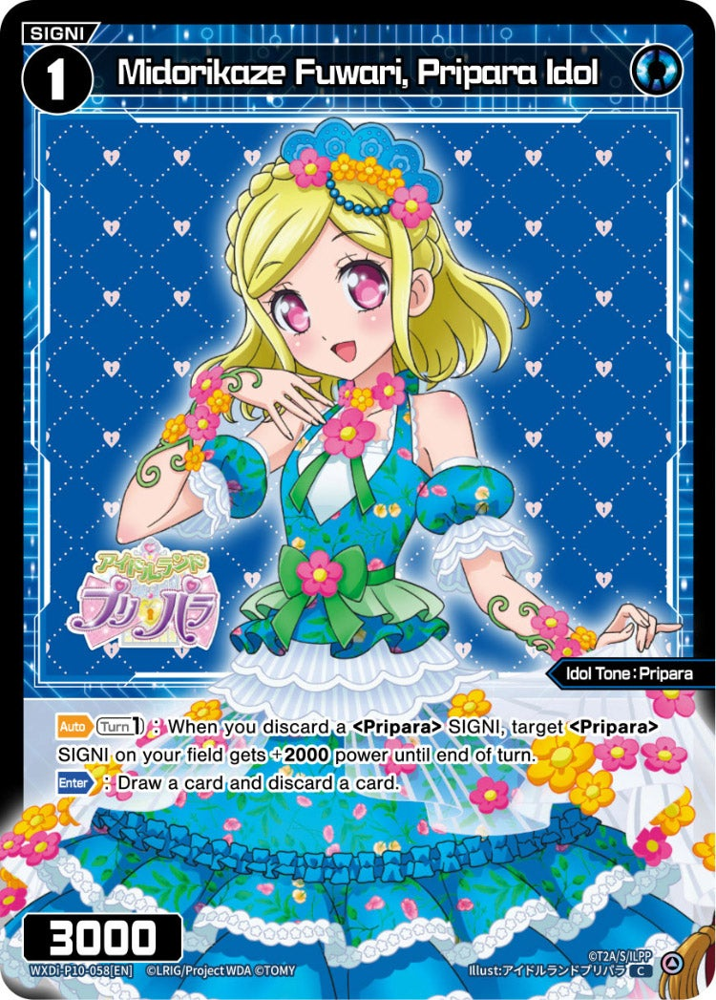

# Midorikaze Fuwari, Pripara Idol

## Thông tin lá

| Trường | Giá trị |
| --- | --- |
| Mã in | WXDi-P10-058[EN] |
| Set | WXDi-P10[EN] |
| Số thứ tự | 058 |
| Loại thẻ | SIGNI |
| Vị trí | Main Deck |
| Số bản | — (set booster, không áp dụng) |
| Màu | Xanh dương |
| Độ hiếm | C,C(P) |
| Minh họa | アイドルランドプリパラ |
| Level | 1 |
| Limit | — |
| Power | 3000 |
| LRIG type / Class | Idol Tone：Pripara |
| Team / Master | — |
| Cost | — |
| Grow cost | — |
| Use timing | — |
| Life Burst | Không |

## Card text chính thức

[Auto] {1/Turn}: When you discard a <Pripara> SIGNI, target <Pripara> SIGNI on your field gets +2000 power until end of turn.
[Enter]: Draw a card and discard a card.

## Power text / Life Burst

—

## Ghi chú minh họa
Artist: アイドルランドプリパラ. Ảnh C được tải từ Card List tiếng Anh.

## FAQ chính thức

**Q. Will this card's [Auto] ability be triggered by this card's [Enter] ability?**
A. Yes, it will trigger.

## Ảnh biến thể

- [C(P)](../images/WXDi-P10-058P-EN.jpg)

## Nguồn
[Card List/FAQ chính thức](https://www.takaratomy.co.jp/products/en.wixoss/card/card.html?card_no=WXDi-P10-058%5BEN%5D ) · [Ảnh thẻ](https://www.takaratomy.co.jp/products/en.wixoss/card/thumb/WXDi-P10-058%5BEN%5D.jpg)
