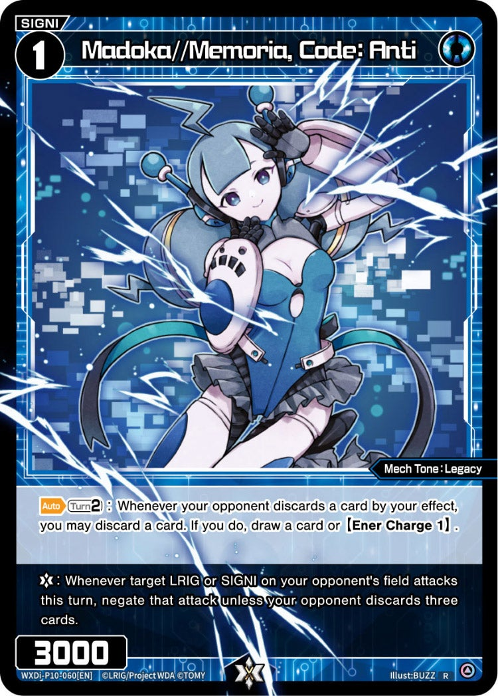

# Madoka//Memoria, Code: Anti

## Thông tin lá

| Trường | Giá trị |
| --- | --- |
| Mã in | WXDi-P10-060[EN] |
| Set | WXDi-P10[EN] |
| Số thứ tự | 060 |
| Loại thẻ | SIGNI |
| Vị trí | Main Deck |
| Số bản | — (set booster, không áp dụng) |
| Màu | Xanh dương |
| Độ hiếm | R,R(P) |
| Minh họa | BUZZ |
| Level | 1 |
| Limit | — |
| Power | 3000 |
| LRIG type / Class | Mech Tone：Legacy |
| Team / Master | — |
| Cost | — |
| Grow cost | — |
| Use timing | — |
| Life Burst | Có |

## Card text chính thức

[Auto] {2/Turn}: Whenever your opponent discards a card by your effect, you may discard a card. If you do, draw a card or 【Ener Charge 1】.

## Power text / Life Burst

Whenever target LRIG or SIGNI on your opponent's field attacks this turn, negate that attack unless your opponent discards three cards.

## Ghi chú minh họa
Artist: BUZZ. Ảnh R được tải từ Card List tiếng Anh.

## FAQ chính thức

**Q. If I used the [Action] ability of 《Yukayuka☆Threee》, then my opponent discard a card from their hand, will this SIGNI's [Auto] ability be triggered?**
A. Yes, that [Auto] ability is triggered because your opponent discard a card by the effect of 《Yukayuka☆Threee》.

## Ảnh biến thể

- [R(P)](../images/WXDi-P10-060P-EN.jpg)

## Nguồn
[Card List/FAQ chính thức](https://www.takaratomy.co.jp/products/en.wixoss/card/card.html?card_no=WXDi-P10-060%5BEN%5D ) · [Ảnh thẻ](https://www.takaratomy.co.jp/products/en.wixoss/card/thumb/WXDi-P10-060%5BEN%5D.jpg)
