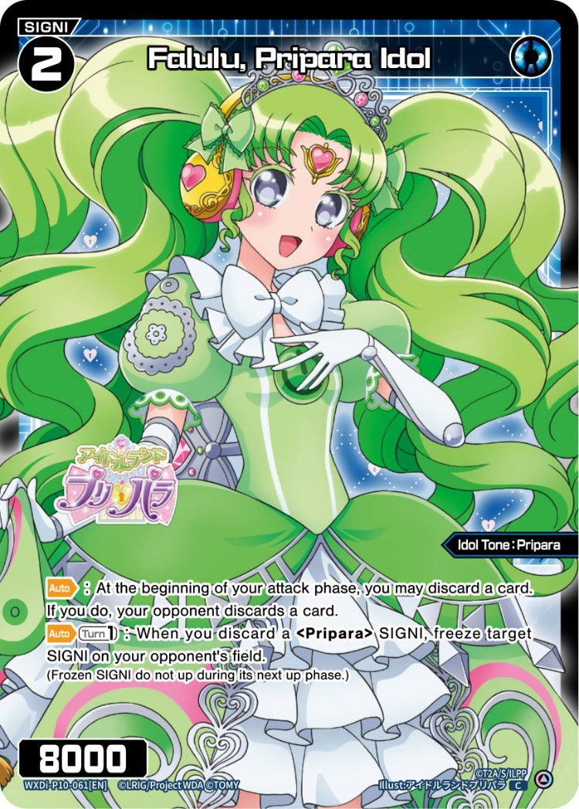

# Falulu, Pripara Idol

## Thông tin lá

| Trường | Giá trị |
| --- | --- |
| Mã in | WXDi-P10-061[EN] |
| Set | WXDi-P10[EN] |
| Số thứ tự | 061 |
| Loại thẻ | SIGNI |
| Vị trí | Main Deck |
| Số bản | — (set booster, không áp dụng) |
| Màu | Xanh dương |
| Độ hiếm | C,C(P) |
| Minh họa | アイドルランドプリパラ |
| Level | 2 |
| Limit | — |
| Power | 8000 |
| LRIG type / Class | Idol Tone：Pripara |
| Team / Master | — |
| Cost | — |
| Grow cost | — |
| Use timing | — |
| Life Burst | Không |

## Card text chính thức

[Auto]: At the beginning of your attack phase, you may discard a card. If you do, your opponent discards a card.
[Auto] {1/Turn}: When you discard a <Pripara> SIGNI, freeze target SIGNI on your opponent's field.
(Frozen SIGNI do not up during its next up phase.)

## Power text / Life Burst

—

## Ghi chú minh họa
Artist: アイドルランドプリパラ. Ảnh C được tải từ Card List tiếng Anh.

## FAQ chính thức

**Q. Will the second [Auto] ability be triggered if I discard a card from my hand by the first [Auto] ability?**
A. Yes, it will trigger. First, your opponent discard a card from their hand with the first [Auto] ability, then the second [Auto] ability is triggered, choosing the target SIGNI and freezing.

## Ảnh biến thể

- [C(P)](../images/WXDi-P10-061P-EN.jpg)

## Nguồn
[Card List/FAQ chính thức](https://www.takaratomy.co.jp/products/en.wixoss/card/card.html?card_no=WXDi-P10-061%5BEN%5D ) · [Ảnh thẻ](https://www.takaratomy.co.jp/products/en.wixoss/card/thumb/WXDi-P10-061%5BEN%5D.jpg)
