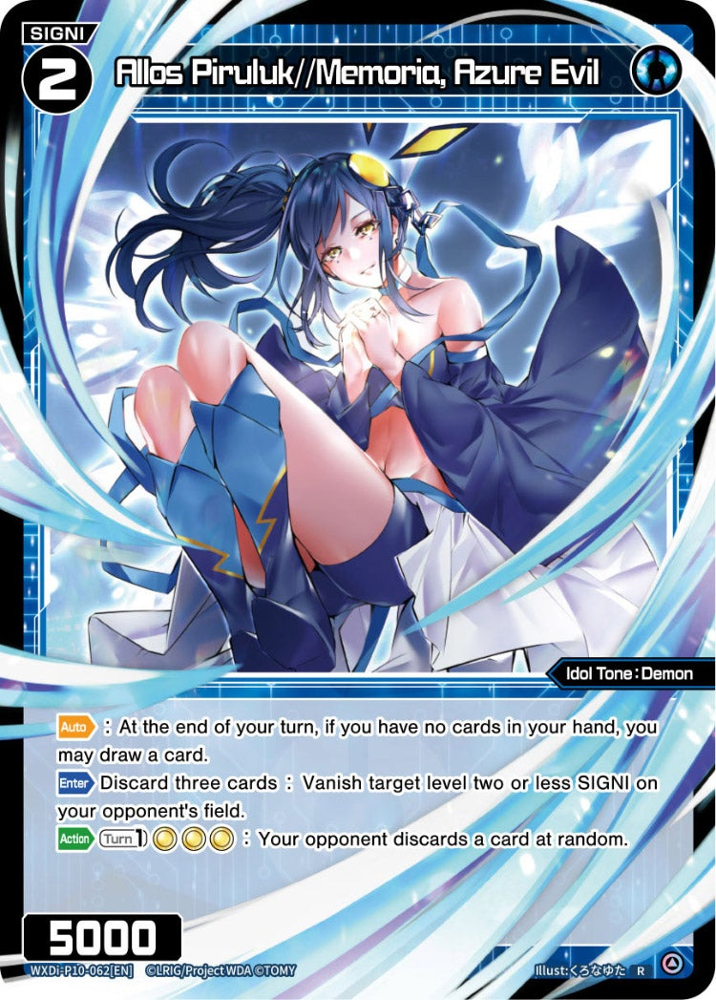

# Allos Piruluk//Memoria, Azure Evil

## Thông tin lá

| Trường | Giá trị |
| --- | --- |
| Mã in | WXDi-P10-062[EN] |
| Set | WXDi-P10[EN] |
| Số thứ tự | 062 |
| Loại thẻ | SIGNI |
| Vị trí | Main Deck |
| Số bản | — (set booster, không áp dụng) |
| Màu | Xanh dương |
| Độ hiếm | R,R(P) |
| Minh họa | くろなゆた |
| Level | 2 |
| Limit | — |
| Power | 5000 |
| LRIG type / Class | Idol Tone：Demon |
| Team / Master | — |
| Cost | — |
| Grow cost | — |
| Use timing | — |
| Life Burst | Không |

## Card text chính thức

[Auto]: At the end of your turn, if you have no cards in your hand, you may draw a card.
[Enter] Discard three cards: Vanish target level two or less SIGNI on your opponent's field.
[Action] {1/Turn} {Coin Icon} {Coin Icon} {Coin Icon}: Your opponent discards a card at random.

## Power text / Life Burst

—

## Ghi chú minh họa
Artist: くろなゆた. Ảnh R được tải từ Card List tiếng Anh.

## FAQ chính thức

**Q. If there are two 《Allos Piruluk//Memoria, Azure Evil》 on my field at the end of my turn, may I draw two cards with this [Auto] abilities?**
A. No, you can only draw a card. The two [Auto] abilities are triggered in order. If you draw a card in the first [Auto] ability, you will not be able to draw a card because your hand is not zero at the time of the second [Auto] ability resolving.

## Ảnh biến thể

- [R(P)](../images/WXDi-P10-062P-EN.jpg)

## Nguồn
[Card List/FAQ chính thức](https://www.takaratomy.co.jp/products/en.wixoss/card/card.html?card_no=WXDi-P10-062%5BEN%5D ) · [Ảnh thẻ](https://www.takaratomy.co.jp/products/en.wixoss/card/thumb/WXDi-P10-062%5BEN%5D.jpg)
