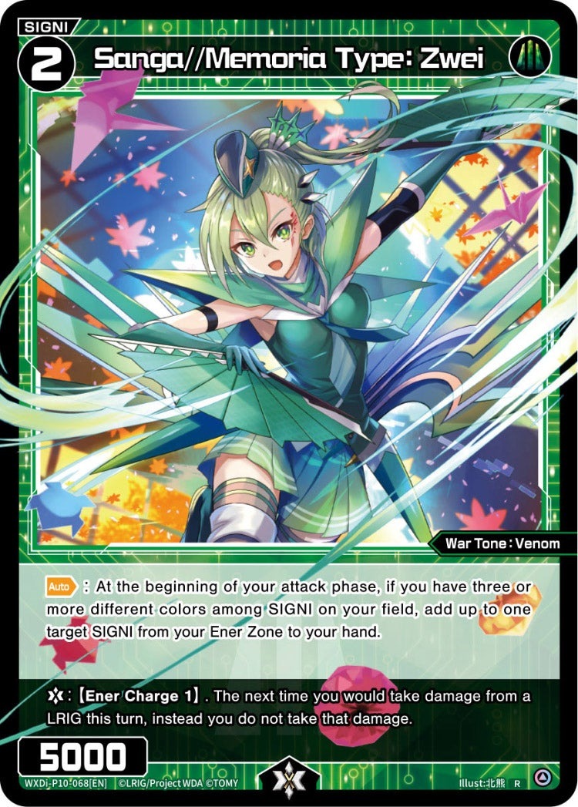

# Sanga//Memoria Type: Zwei

## Thông tin lá

| Trường | Giá trị |
| --- | --- |
| Mã in | WXDi-P10-068[EN] |
| Set | WXDi-P10[EN] |
| Số thứ tự | 068 |
| Loại thẻ | SIGNI |
| Vị trí | Main Deck |
| Số bản | — (set booster, không áp dụng) |
| Màu | Xanh lá |
| Độ hiếm | R,R(P) |
| Minh họa | 北熊 |
| Level | 2 |
| Limit | — |
| Power | 5000 |
| LRIG type / Class | War Tone：Venom |
| Team / Master | — |
| Cost | — |
| Grow cost | — |
| Use timing | — |
| Life Burst | Có |

## Card text chính thức

[Auto]: At the beginning of your attack phase, if you have three or more different colors among SIGNI on your field, add up to one target SIGNI from your Ener Zone to your hand.

## Power text / Life Burst

【Ener Charge 1】. The next time you would take damage from a LRIG this turn, instead you do not take that damage.

## Ghi chú minh họa
Artist: 北熊. Ảnh R được tải từ Card List tiếng Anh.

## FAQ chính thức

**Q. As count the total color of SIGNI on my field, may I count cards underneath SIGNI?**
A. No, you don't count. When referring to the SIGNI on your field, there are only SIGNI that are served as SIGNI (the limit of levels and limits), and do not including the cards attached and the cards that are underneath the SIGNI.

## Ảnh biến thể

- [R(P)](../images/WXDi-P10-068P-EN.jpg)

## Nguồn
[Card List/FAQ chính thức](https://www.takaratomy.co.jp/products/en.wixoss/card/card.html?card_no=WXDi-P10-068%5BEN%5D ) · [Ảnh thẻ](https://www.takaratomy.co.jp/products/en.wixoss/card/thumb/WXDi-P10-068%5BEN%5D.jpg)
