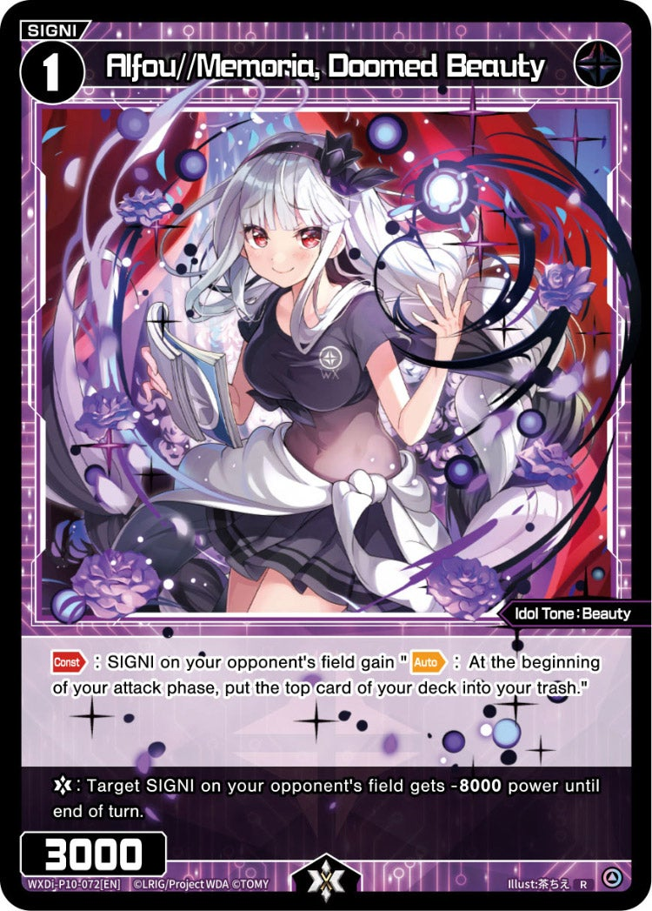

# Alfou//Memoria, Doomed Beauty

## Thông tin lá

| Trường | Giá trị |
| --- | --- |
| Mã in | WXDi-P10-072[EN] |
| Set | WXDi-P10[EN] |
| Số thứ tự | 072 |
| Loại thẻ | SIGNI |
| Vị trí | Main Deck |
| Số bản | — (set booster, không áp dụng) |
| Màu | Đen |
| Độ hiếm | R,R(P) |
| Minh họa | 茶ちえ |
| Level | 1 |
| Limit | — |
| Power | 3000 |
| LRIG type / Class | Idol Tone：Beauty |
| Team / Master | — |
| Cost | — |
| Grow cost | — |
| Use timing | — |
| Life Burst | Có |

## Card text chính thức

[Constant]: SIGNI on your opponent's field gain "[Auto]: At the beginning of your attack phase, put the top card of your deck into your trash."

## Power text / Life Burst

Target SIGNI on your opponent's field gets -8000 power until end of turn.

## Ghi chú minh họa
Artist: 茶ちえ. Ảnh R được tải từ Card List tiếng Anh.

## FAQ chính thức

**Q. If there are three SIGNI on my opponent's field, will each SIGNI give [Auto] ability with this effect?**
A. Yes, all SIGNI on your opponent's field gain the [Auto] ability.

**Q. If there are three 《Alfou//Memoria, Doomed Beauty》 on my field, will my opponent's SIGNI gain multiple [Auto] abilities?**
A. Yes, three [Auto] abilities are gained by the three 《Alfou//Memoria, Doomed Beauty》. If there are three 《Alfou//Memoria, Doomed Beauty》 in your field and there are three SIGNI in your opponent's field, your opponent put total of nine cards on the top of their deck into trash at the beginning of your opponent's attack phase.

## Ảnh biến thể

- [R(P)](../images/WXDi-P10-072P-EN.jpg)

## Nguồn
[Card List/FAQ chính thức](https://www.takaratomy.co.jp/products/en.wixoss/card/card.html?card_no=WXDi-P10-072%5BEN%5D ) · [Ảnh thẻ](https://www.takaratomy.co.jp/products/en.wixoss/card/thumb/WXDi-P10-072%5BEN%5D.jpg)
